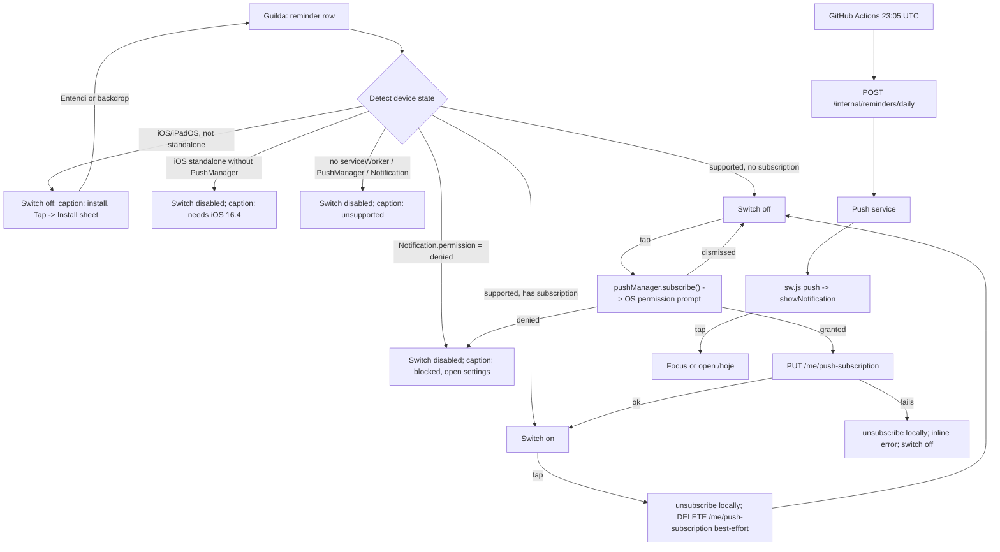

# Daily reminder: a 20h Web Push nudge to mark today's quests

Status: Done (runbook pending)
Last updated: 2026-10-13
Depends on: none to start. Builds on what [`quest-entries.md`](./quest-entries.md) already shipped: the `entries` table, `rules.frequency`/`score_type`, `EntryRepository.ListByMember`, and the `America/Sao_Paulo` location in `back-end/cmd/webapp/main.go:42`. Deploy setup comes from [`ci-cd-deploy.md`](./ci-cd-deploy.md) (Fly app, `make fly-secrets`, GitHub Actions).
Runbook: [runbooks/daily-reminder-push.md](../runbooks/daily-reminder-push.md)

## Summary
Every evening at around 20:00 (São Paulo time), each guild member who opted in on a device and still has at least one daily quest unchecked today gets a Web Push notification on that device: "Bora fechar o dia?". Tapping it opens Hoje. A switch on the Guilda tab turns this on or off per device. On iPhone/iPad the switch first walks the member through installing the app to the Home Screen, because iOS only allows Web Push there. A GitHub Actions scheduled workflow calls a secret-protected back-end endpoint once a day; the back-end decides who gets notified and sends the pushes.

## Problem
Members forget to check off quests they actually did, so the scoreboard under-counts and the weekly race feels unfair. Nothing in the app reaches a member outside of the moment they open it. There is no notification channel, no service worker, and no scheduler anywhere in the repo today (see Current state).

## Goals
- A member who turned the reminder on and still has an unchecked daily quest gets exactly one notification per day per device, arriving between 20:00 and 23:00 in `America/Sao_Paulo` (normally around 20:05 to 20:35).
- A member who already checked every daily quest today gets nothing.
- On iPhone/iPad, a member in a Safari tab is never shown a permission prompt that can't work. Instead they see the steps to install, and after installing they can turn the reminder on from the installed app.
- On a device that can't receive Web Push, the switch is visibly disabled with a one-line reason.
- Dead subscriptions (app removed, permission revoked) clean themselves up on the next send.

## Non-goals
- **Email, SMS or in-app banners.** Web Push only (Decision log #1).
- **Per-user reminder time or multiple reminders per day.** Fixed 20:00 for everyone. Deferred to a follow-up spec.
- **Weekly quests and slips.** Only daily `sum` rules make someone eligible (Business rule 3).
- **Offline mode or caching in the service worker.** The new `public/sw.js` handles `push` and `notificationclick` only. Offline support is a separate follow-up (Decision log #8).
- **Parental control over children's notifications.** Each member opts in on their own device (Decision log #7).
- **A custom in-app install button (`beforeinstallprompt`).** Not supported on iOS Safari; the Next.js guide recommends against it (`front-end/node_modules/next/dist/docs/01-app/02-guides/progressive-web-apps.md:597`).
- **Fixing the 24h JWT TTL** (`back-end/cmd/webapp/main.go:27`). If a session has expired, tapping the notification lands on `/entrar` through `AuthGate`, which is acceptable.

## Current state
- **No Web Push or service worker anywhere.** `front-end/public/` contains only `avatars/` and `icons/`; there is no `sw.js`. No `PushManager`/`serviceWorker` code exists in `front-end/` (outside `node_modules`). `front-end/README.md:46` lists "No service worker" under "Not done yet".
- **PWA basics exist.** `front-end/app/manifest.ts` has `display: "standalone"` and `start_url: "/hoje"`, and `front-end/app/layout.tsx:24` sets `appleWebApp.capable`. WebKit requires a manifest with `display` `standalone`/`fullscreen` for a Home Screen web app, which is already satisfied.
- **No scheduler.** The back-end has no cron, ticker or job runner. `back-end/fly.toml:16-18` has `auto_stop_machines = "stop"` and `min_machines_running = 0`, so the API machine is usually stopped and an in-process timer would not fire. An HTTP request through Fly's proxy starts it (`auto_start_machines = true`).
- **Timezone.** `main.go:42` loads `America/Sao_Paulo` once and passes it to `EntryService`/`ScoreboardService`/`WeekHistoryService`. `entry.DateOnly` (`back-end/internal/src/domain/entry/entry.go:77`) turns a local time into the date key used by `entries.occurred_on`.
- **"Done today" is already computable.** Hoje treats a member's daily quests as `rules.filter(r => r.scoreType === "sum" && r.frequency === "daily")` and counts one as done when an entry with that `ruleId` and `scoreType === "sum"` exists today (`front-end/app/(tabs)/hoje/page.tsx:123,128`). On the back-end, `EntryRepository.ListByMember(ctx, guildID, memberID, from, to)` returns entries with `occurred_on BETWEEN from AND to` (`back-end/internal/src/infrastructure/postgres/entry_repository.go:97-102`). `RuleRepository.ListByGuild` is in `back-end/internal/src/app/service/rule_service.go:12`.
- **Guilds.** `GuildRepository` (`back-end/internal/src/infrastructure/postgres/guild_repository.go`) has `Get` and `FindByMember` only; there is no "list all guilds". `guild.Guild{ID, Name, UserIDs}` (`back-end/internal/src/domain/guild/guild.go`). Each user has at most one guild (`guild_members.user_id` is the PK, `0004_guilds.sql:10`).
- **Users** have no timezone or notification fields (`back-end/internal/src/domain/user/user.go:38-44`).
- **Auth.** `middleware.RequireAuth` reads `Authorization: Bearer <jwt>` (`back-end/internal/src/interface/http/middleware/auth.go`). No machine-to-machine auth exists yet.
- **Routes** are registered in `back-end/cmd/webapp/routes/routes.go`; `/me` already exists as an authed group (`:34-35`).
- **Migrations.** The highest existing file is `0009_week_history.sql`, so this spec's migration is `0010` (check again before naming it).
- **Secrets.** `back-end/scripts/fly-secrets.sh:19` whitelists exactly `DATABASE_URL JWT_SECRET CLOUDINARY_CLOUD_NAME CLOUDINARY_API_KEY CLOUDINARY_API_SECRET`. `back-end/.env.example:17-19` lists the Cloudinary keys. New secrets must be added to both.
- **Sign out.** The only sign-out is the "Sair" button on Regras, `onClick={clearSession}` (`front-end/app/(tabs)/regras/page.tsx:229`). `clearSession` is also called automatically on any 401 (`front-end/lib/api.ts:39,54`).
- **Guilda** (`front-end/app/(tabs)/guilda/page.tsx`) shows the prize card and the standings list. It has no primary `.bq-btn`; "Pedir auditoria" is `variant="small"`.
- **No switch/toggle component** exists in `front-end/components/ui.tsx`. `Icon.tsx` has no `bell` icon.
- **Integration tests** wire the router in `back-end/test/integration/main_test.go:88-140` with `clock.SystemClock{}` and a fake for Cloudinary (`fakePhotoStore`, `:163-172`). This spec follows the same pattern with a fake push sender and a fixed clock.

Must not break: every existing route, Hoje's check flow, Regras' "Sair", the 100% coverage gate.

### Verified platform facts (iOS and scheduler)
- **iOS/iPadOS Web Push** exists since 16.4 and only for web apps added to the Home Screen. Permission can only be requested "in response to direct user interaction", such as tapping a subscribe button. The manifest `display` must be `standalone` or `fullscreen`, otherwise the site is saved as a bookmark. No Apple Developer Program membership is needed. Sources: [WebKit, "Web Push for Web Apps on iOS and iPadOS"](https://webkit.org/blog/13878/web-push-for-web-apps-on-ios-and-ipados/); [9to5Mac](https://9to5mac.com/2023/02/16/iphone-web-app-new-features-ios-16-4/) confirms a regular Safari tab cannot request push permission. The Next.js guide states the same: "iOS 16.4+ for applications installed to the home screen" (`front-end/node_modules/next/dist/docs/01-app/02-guides/progressive-web-apps.md:88`).
- **iOS 26 / iPadOS 26 Add to Home Screen** (verified): every website added to the Home Screen now opens as a web app by default, and the "Add to Home Screen" dialog has an "Open as Web App" toggle that is on by default. Turning it off creates a plain bookmark that opens in the browser. Sources: [WebKit, "News from WWDC25: WebKit in Safari 26 beta"](https://webkit.org/?p=16993), [heise](https://heise.de/-10749652). For Boraquest this changes nothing technically, because the manifest already makes it a web app. The install steps add one line telling people to leave that option on (Copy table).
- **Apple's push service** rejects a VAPID JWT whose `sub` claim is not a valid `mailto:` or `https:` URL, returning 403 `BadJwtToken`. Malformed forms such as `mailto: <x@y>` with a space or angle brackets, `localhost` or `.local` addresses are rejected. Sources: [pywebpush issue #175 quoting Apple's doc](https://github.com/web-push-libs/pywebpush/issues/175), [Apple Developer Forums 725473](https://developer.apple.com/forums/thread/725473), [RFC 8292](https://datatracker.ietf.org/doc/html/rfc8292).
- **GitHub Actions `schedule`** runs in UTC, only on the default branch, and can be delayed under load, especially at the top of the hour; heavily loaded runs may be dropped. Scheduled workflows are disabled after 60 days without repository activity, and the minimum interval is 5 minutes. Sources: [Flutter infra doc quoting GitHub](https://flutter.googlesource.com/mirrors/flutter/+/refs/heads/main/docs/infra/Scheduled-Recurring-Tasks.md), [GitHub community discussion](https://github.com/orgs/community/discussions/201738), [itime.day summary](https://itime.day/articles/github-actions-cron-delays). The user accepted "around 20:00".
- **Go library:** `github.com/SherClockHolmes/webpush-go` does the payload encryption and VAPID signing (`SendNotification(message, *Subscription, *Options)`, `GenerateVAPIDKeys()`). Source: its README, mirrored [here](https://git.terinstock.com/gotosocial.git/plain/vendor/github.com/SherClockHolmes/webpush-go/README.md?h=v0.20.3).

## User stories
- As a guild member who forgets to check things off, I want a nudge in the evening, so that my score reflects what I actually did.
- As a member who already checked everything, I want no notification, so that the app never nags me for nothing.
- As an iPhone user browsing in Safari, I want clear steps to install the app, so that I can turn the reminder on at all.
- As a member on an unsupported device or browser, I want to see why the switch is off, so that I don't keep tapping it.
- As a member who shares a tablet with family, I want signing out to stop that device's reminders for me, so that the next person isn't nudged about my quests.

## UX flow



### Guilda: reminder row (new, `components/ReminderSwitch.tsx`)
- **Placement:** below the standings list (or below the loading/error state if the list hasn't loaded), always rendered once `session` is known. It's a settings row in its own card, not part of the list, so it doesn't count as a second list (BRAND "A few things per screen").
- **Layout:** one `.bq-card`-style row (`radius-md`, `shadow-card`, white `surface`), min height 64px: a new `bell` icon on the left, then a title ("Lembrete às 20h") and a caption line under it, then a switch on the right. The whole row is the tap target (≥48px high). Use the `bq-*` row spacing used by `QuestRow`.
- **Switch visual (new `.bq-switch` in `front-end/app/globals.css`):** a 52×32px pill track inside a ≥48px hit area. Off: `line-strong` border, `surface` fill, knob left. On: `accent` fill, `ink` knob right. Disabled: 50% opacity. The knob slides in 150ms; under `prefers-reduced-motion: reduce` there is no transition. The caption always states the state in words, so color is never the only signal.
- **Primary action:** none. Guilda still has no `.bq-btn` primary, and this row doesn't add one.
- **States** (copy in Copy table):
  | State | When | Switch | Tap does |
  | --- | --- | --- | --- |
  | `checking` | First render until detection finishes (one tick plus `getSubscription()`) | off, disabled | nothing |
  | `ios-install` | iOS/iPadOS and not standalone (Business rule 11) | off, enabled-looking | opens the Install sheet; **never** calls `requestPermission`/`subscribe` |
  | `ios-too-old` | iOS/iPadOS, standalone, but `"PushManager" in window` is false | off, disabled | nothing |
  | `unsupported` | not iOS, and any of `serviceWorker`, `PushManager`, `Notification` is missing | off, disabled | nothing |
  | `denied` | `Notification.permission === "denied"` | off, disabled | nothing |
  | `off` | supported, permission not denied, no browser subscription | off | Turn on |
  | `on` | supported and `registration.pushManager.getSubscription()` is non-null | on | Turn off |
  | `busy` | while turning on/off | shows target state, disabled | nothing |
  | `error` | turning on failed after permission | off, enabled, inline note under row (`role="alert"`) | Turn on again |
- **Turn on (must run inside the tap handler):** the VAPID public key and the service worker registration are preloaded when the row mounts. In the click handler, the **first** awaited call is `registration.pushManager.subscribe({ userVisibleOnly: true, applicationServerKey })`, which itself triggers the OS permission prompt. No `await` comes before it, so iOS still treats it as the user's gesture (Business rule 12). Then:
  - On success, `PUT /api/v1/me/push-subscription` with `subscription.toJSON()`. If that request fails, call `subscription.unsubscribe()` and show the `error` state.
  - If `subscribe` rejects and `Notification.permission` is now `"denied"`, go to `denied`. If it is still `"default"` (the member dismissed the prompt), go back to `off` without an error. Any other rejection goes to `error`.
- **Turn off:** `subscription.unsubscribe()` first, then `DELETE /api/v1/me/push-subscription` as best effort, then `off`. If the DELETE fails, still show `off`; the back-end removes the row on the next send when the push service answers 404/410 (Business rule 9).

### Install sheet (iOS/iPadOS only, new, uses existing `Sheet`)
- **Purpose:** explain that iPhone/iPad only gets reminders in the installed app, and how to install it.
- **Layout:** follows `TelaGuilda`'s "Pedir auditoria" sheet (`guilda/page.tsx:149-176`): `bq-stack` with a title (`bq-title`), one sentence (`bq-text`), then an ordered list of 3 steps (`bq-text`, numbered), one note line (`bq-caption`), and one block primary `Button`.
- **Primary action:** "Entendi", which closes the sheet. The backdrop also closes it.
- No permission is requested from this sheet.

### Notification (system UI, from `public/sw.js`)
- Title "Bora fechar o dia?", body "Marca as quests que você fez hoje.", icon `/icons/icon-192.png`, `tag: "daily-reminder"` (a newer one replaces an older one), `data.url: "/hoje"`.
- **Tap:** close the notification, then focus an existing Boraquest window and `navigate("/hoje")`. If no window is open, `clients.openWindow("/hoje")`. If the session has expired, `AuthGate` sends the member to `/entrar` as usual.

### Sign out (Regras, changed behavior only)
- "Sair" calls a new `signOut()` (`lib/push.ts`). It looks up this device's subscription. If there is one, it calls `DELETE /me/push-subscription` while the token is still valid, then `subscription.unsubscribe()`, then `clearSession()`. Push cleanup is best effort with a 3s timeout: sign-out always completes, even offline.

### Service worker lifecycle (no UI)
- `components/ServiceWorkerRegistrar.tsx` (client, rendered once inside `AuthGate` in `app/(tabs)/layout.tsx`) registers `/sw.js` with `{ scope: "/", updateViaCache: "none" }` when `"serviceWorker" in navigator`. Then, if a session exists and `getSubscription()` is non-null, it re-sends `PUT /me/push-subscription` once per app load (Business rule 8). Errors are swallowed silently.

## Copy (pt-BR)
| Key / location | Text |
| --- | --- |
| Guilda row, title | Lembrete às 20h |
| Guilda row, caption `off` / `error` | Um aviso se faltar quest no dia. |
| Guilda row, caption `on` | Ligado neste aparelho. |
| Guilda row, caption `checking` | Verificando… |
| Guilda row, caption `ios-install` | Instale o app para ligar. |
| Guilda row, caption `ios-too-old` | Precisa do iOS 16.4 ou mais novo. |
| Guilda row, caption `unsupported` | Este navegador não recebe lembretes. |
| Guilda row, caption `denied` | Notificações bloqueadas. Libere nos ajustes do aparelho. |
| Guilda row, inline error (`role="alert"`) | Não deu para ligar o lembrete. Tenta de novo. |
| Switch `aria-label` | Lembrete às 20h |
| Install sheet, title | Instale o Boraquest |
| Install sheet, sentence | No iPhone e no iPad, o lembrete só funciona no app instalado. |
| Install sheet, step 1 | Toque em Compartilhar no Safari. |
| Install sheet, step 2 | Escolha Adicionar à Tela de Início. |
| Install sheet, step 3 | Abra o Boraquest pelo ícone e ligue o lembrete aqui na Guilda. |
| Install sheet, note | Se aparecer a opção de abrir como app, deixe ligada. |
| Install sheet, button | Entendi |
| Notification title | Bora fechar o dia? |
| Notification body | Marca as quests que você fez hoje. |

## Business rules
1. **Send window.** The daily run only sends when the current time in `America/Sao_Paulo` is ≥ 20:00 and < 23:00. Outside it, the endpoint returns 409 `outside_window` and sends nothing, unless `force` is true (rule 10).
2. **"Today"** is `entry.DateOnly(clock.Now().In(loc))` with the existing `America/Sao_Paulo` location, the same day boundary as Hoje.
3. **Eligibility.** A user is notified on a given day only if all of these hold: (a) they belong to a guild; (b) that guild has ≥1 rule with `frequency = daily` and `score_type = sum`; (c) for at least one of those rules there is no entry with that `rule_id`, `member_id = user`, `score_type = sum`, `occurred_on = today`; (d) they have ≥1 stored push subscription. Weekly rules and `decrease` rules never count.
4. **At most one reminder per user per day.** Before sending to a user, the run claims `(user_id, day)` in `daily_reminders` with an insert that does nothing on conflict. If the claim already exists, that user is skipped. A claim is kept even if every device send fails; there is no retry later that day. Retried or duplicate cron calls are therefore safe.
5. **Per device.** A user's reminder goes to every subscription they have, so one notification per device per day.
6. **Payload** is fixed (Copy table), with `TTL = 10800` seconds (3h, so a phone that's offline doesn't get "fechar o dia" the next morning), `Urgency: normal`, and `Topic: daily-reminder`. The payload contains no names, points or quest names.
7. **Subscription ownership.** A subscription is keyed by its `endpoint` (unique). Saving an endpoint that already exists reassigns it to the caller and replaces its keys, which covers a shared device that changes user. A user can have at most 10 subscriptions; saving an 11th deletes that user's least recently updated one.
8. **Re-sync.** Each app load with a session and a browser subscription re-saves it (upsert). This keeps the back-end in sync after a different member signs in on the same device, or if a row was lost.
9. **Dead subscriptions.** When the push service answers 404 or 410 for a subscription, that row is deleted immediately. Any other failure (5xx, timeout, 403) is counted as failed and logged, and the row is kept.
10. **Manual trigger.** The cron endpoint accepts `{"force": true}` to skip the time window (rule 1), and optionally `"userId"` to limit the run to that one user. With `userId` set, the per-day claim (rule 4) is also skipped and nothing is written to `daily_reminders`. Eligibility (rule 3) always applies. This exists so the feature can be tested on a real iPhone at any hour.
11. **iOS install gate.** On iOS/iPadOS, the app never calls `Notification.requestPermission` or `pushManager.subscribe` unless it runs standalone. iOS/iPadOS means `/iPad|iPhone|iPod/.test(navigator.userAgent)`, or `navigator.platform === "MacIntel" && navigator.maxTouchPoints > 1` for iPadOS desktop-mode UA. Standalone means `navigator.standalone === true` or `matchMedia("(display-mode: standalone)").matches`.
12. **Permission only from a tap.** Permission is requested only from the switch's click handler, through `pushManager.subscribe` as the first awaited call. Nothing ever prompts on page load.
13. **Opt-in is per device and off by default.** Nothing is subscribed until the member turns the switch on, on that device.
14. **Sign out** removes this device's subscription for the signed-out user (best effort, rule 9 covers the rest).
15. **Cron auth.** `POST /api/v1/internal/reminders/daily` requires `Authorization: Bearer <REMINDER_CRON_SECRET>`, compared in constant time. A missing or wrong secret returns 401 and does nothing.

## Data model

### Back-end domain, new package `back-end/internal/src/domain/push/push.go`
```go
// Package push holds the domain model for Web Push subscriptions.
package push

var (
	ErrInvalidSubscription = errors.New("push: invalid subscription")
	ErrGone                = errors.New("push: subscription no longer valid") // push service said 404/410
)

const (
	MaxEndpointLen = 2048
	MaxPerUser     = 10
)

// Subscription is one device's Web Push endpoint for one user.
type Subscription struct {
	ID        string    // uuid
	UserID    string    // users.id
	Endpoint  string    // https URL from PushSubscription.endpoint; unique across all users
	P256dh    string    // base64url, decodes to 65 bytes (uncompressed P-256 point)
	Auth      string    // base64url, decodes to 16 bytes
	CreatedAt time.Time
	UpdatedAt time.Time
}

// New validates and builds a Subscription. endpoint must parse as an absolute https URL
// of at most MaxEndpointLen bytes; p256dh and auth must be unpadded or padded base64url
// decoding to 65 and 16 bytes. Any failure returns ErrInvalidSubscription.
func New(id, userID, endpoint, p256dh, auth string, now time.Time) (Subscription, error)
```

### Back-end domain, new package `back-end/internal/src/domain/reminder/reminder.go`
```go
// Package reminder holds the rules of the daily "mark your quests" reminder.
package reminder

var ErrOutsideWindow = errors.New("reminder: outside the daily send window")

const (
	WindowStartHour = 20 // inclusive, America/Sao_Paulo
	WindowEndHour   = 23 // exclusive
	TTLSeconds      = 10800
	Topic           = "daily-reminder"
)

// Payload is the JSON body the service worker reads.
type Payload struct {
	Title string `json:"title"`
	Body  string `json:"body"`
	URL   string `json:"url"`
	Tag   string `json:"tag"`
}

// Daily returns the fixed daily payload (Copy table).
func Daily() Payload // {"Bora fechar o dia?", "Marca as quests que você fez hoje.", "/hoje", "daily-reminder"}

// InWindow reports whether local (already in America/Sao_Paulo) is in [20:00, 23:00).
func InWindow(local time.Time) bool

// NeedsReminder reports whether any rule in dailySumRuleIDs is missing from doneRuleIDs.
// It is false when dailySumRuleIDs is empty.
func NeedsReminder(dailySumRuleIDs, doneRuleIDs []string) bool
```

### Postgres, new migration `back-end/internal/src/infrastructure/postgres/migrations/0010_push_reminders.sql`
```sql
-- +goose Up
CREATE TABLE push_subscriptions (
    id         TEXT PRIMARY KEY,
    user_id    TEXT NOT NULL REFERENCES users (id) ON DELETE CASCADE,
    endpoint   TEXT NOT NULL UNIQUE,
    p256dh     TEXT NOT NULL,
    auth       TEXT NOT NULL,
    created_at TIMESTAMPTZ NOT NULL,
    updated_at TIMESTAMPTZ NOT NULL
);
CREATE INDEX push_subscriptions_user_id_idx ON push_subscriptions (user_id);

CREATE TABLE daily_reminders (
    user_id TEXT NOT NULL REFERENCES users (id) ON DELETE CASCADE,
    day     DATE NOT NULL,
    sent_at TIMESTAMPTZ NOT NULL,
    PRIMARY KEY (user_id, day)
);

-- +goose Down
DROP TABLE daily_reminders;
DROP TABLE push_subscriptions;
```
This is purely additive, so it is safe with the running release (expand/contract, per `CLAUDE.md`).

### Front-end, `front-end/lib/api.ts` additions
```ts
export type PushSubscriptionInput = { endpoint: string; keys: { p256dh: string; auth: string } };
export const getPushPublicKey = () => apiFetch<{ publicKey: string }>("/push/public-key");
export const savePushSubscription = (s: PushSubscriptionInput) => apiFetch<void>("/me/push-subscription", "PUT", s);
export const deletePushSubscription = (endpoint: string) => apiFetch<void>("/me/push-subscription", "DELETE", { endpoint });
```

### Front-end, new `front-end/lib/push.ts`
```ts
export type ReminderState =
  | "checking" | "ios-install" | "ios-too-old" | "unsupported" | "denied" | "off" | "on" | "busy" | "error";
export function isIOS(): boolean;                 // Business rule 11
export function isStandalone(): boolean;          // Business rule 11
export function detectReminderState(): Promise<Exclude<ReminderState, "checking" | "busy" | "error">>;
export function registerServiceWorker(): Promise<ServiceWorkerRegistration | null>;
export function enableReminder(reg: ServiceWorkerRegistration, publicKey: string): Promise<"on" | "off" | "denied" | "error">;
export function disableReminder(): Promise<void>;
export function syncReminder(): Promise<void>;   // Business rule 8
export function signOut(): Promise<void>;        // Business rule 14; always ends in clearSession()
export function urlBase64ToUint8Array(base64: string): Uint8Array; // as in the Next.js guide, :105-116
```

### Diff against `front-end/lib/data.ts`
None.

## Architecture & technical decisions

### Back-end layering (new and changed files)
| Layer | File | Notes |
| --- | --- | --- |
| Domain | `internal/src/domain/push/push.go` (new) | Data model above. |
| Domain | `internal/src/domain/reminder/reminder.go` (new) | Data model above. |
| App | `internal/src/app/service/push_service.go` (new) | `PushSubscriptionRepository` interface; `PushService{Subscribe, Unsubscribe, PublicKey}`. |
| App | `internal/src/app/service/reminder_service.go` (new) | Interfaces `GuildLister`, `ReminderRuleReader`, `ReminderEntryReader`, `ReminderLog`, `PushSender`; `ReminderService.RunDaily`. |
| Infra | `internal/src/infrastructure/postgres/push_subscription_repository.go` (new) | Implements `PushSubscriptionRepository`. |
| Infra | `internal/src/infrastructure/postgres/daily_reminder_repository.go` (new) | Implements `ReminderLog`. |
| Infra | `internal/src/infrastructure/postgres/guild_repository.go` (changed) | Add `ListAll(ctx) ([]guild.Guild, error)` reusing `guildSelect` + `ORDER BY g.id`. |
| Infra | `internal/src/infrastructure/webpush/sender.go` (new) | Implements `PushSender` with `github.com/SherClockHolmes/webpush-go`. |
| Interface | `internal/src/interface/http/controllers/push_controller.go` (new) | `PublicKey`, `Subscribe`, `Unsubscribe`. |
| Interface | `internal/src/interface/http/controllers/reminder_controller.go` (new) | `RunDaily`. |
| Interface | `internal/src/interface/http/middleware/cron.go` (new) | `RequireCronSecret(secret string) gin.HandlerFunc` using `crypto/subtle.ConstantTimeCompare`. |
| Routes | `cmd/webapp/routes/routes.go` | Add `Push`, `Reminders` controllers and a `RequireCron gin.HandlerFunc` to `Controllers`; register routes (API section). |
| Wiring | `cmd/webapp/main.go` | Read `VAPID_PUBLIC_KEY`, `VAPID_PRIVATE_KEY`, `VAPID_SUBJECT`, `REMINDER_CRON_SECRET`; if any is empty, `log.Fatal` (same pattern as Cloudinary, `main.go:37-40`). Build the repositories, sender and services, and pass `loc`. |

```go
// reminder_service.go (sketch: the interfaces are the contract; shape the body freely)
type GuildLister interface{ ListAll(ctx context.Context) ([]guild.Guild, error) }
type ReminderRuleReader interface{ ListByGuild(ctx context.Context, guildID string) ([]rule.Rule, error) }
type ReminderEntryReader interface {
	ListByMember(ctx context.Context, guildID, memberID string, from, to time.Time) ([]entry.Entry, error)
}
// ReminderLog records which users were reminded on which day.
type ReminderLog interface {
	// Claim inserts (userID, day) and reports true, or reports false if it already existed.
	Claim(ctx context.Context, userID string, day, now time.Time) (bool, error)
}
// PushSender delivers one payload to one subscription. It returns push.ErrGone
// when the push service answers 404 or 410.
type PushSender interface {
	Send(ctx context.Context, s push.Subscription, p reminder.Payload) error
}

type RunOptions struct {
	Force  bool
	UserID string // "" = everyone
}
type RunResult struct {
	Day            time.Time // date-only
	UsersEligible  int       // passed Business rule 3
	UsersNotified  int       // claimed (or forced) and had ≥1 device send attempted
	UsersSkipped   int       // eligible but already claimed today
	DevicesSent    int
	DevicesFailed  int
	DevicesRemoved int       // ErrGone -> row deleted
}

func NewReminderService(guilds GuildLister, rules ReminderRuleReader, entries ReminderEntryReader,
	subs PushSubscriptionRepository, log ReminderLog, sender PushSender, clock Clock, loc *time.Location) *ReminderService

// RunDaily:
// 1. local := clock.Now().In(loc); if !opts.Force && !reminder.InWindow(local) -> reminder.ErrOutsideWindow.
// 2. day := entry.DateOnly(local).
// 3. For each guild from ListAll: daily := IDs of rules with FrequencyDaily && ScoreTypeSum; skip guild if empty.
// 4. For each member (or only opts.UserID if set and in this guild):
//    done := RuleIDs of ListByMember(guild, member, day, day) with ScoreTypeSum;
//    if !reminder.NeedsReminder(daily, done) -> continue;
//    subs := ListByUser(member); if none -> continue; UsersEligible++;
//    if opts.UserID == "" { ok := log.Claim(member, day, now); if !ok { UsersSkipped++; continue } }
//    UsersNotified++; for each sub: Send; ErrGone -> DeleteByEndpoint + DevicesRemoved++;
//    other error -> DevicesFailed++ and log.Printf (user id + endpoint host only); nil -> DevicesSent++.
// 5. A repository error aborts the run and is returned (500). Send errors never abort it.
```

```go
// push_service.go
type PushSubscriptionRepository interface {
	// Upsert inserts s or, when s.Endpoint exists, reassigns it to s.UserID with new keys and
	// UpdatedAt. Then, if the user has more than max rows, deletes their oldest by updated_at.
	Upsert(ctx context.Context, s push.Subscription, max int) error
	// DeleteForUser deletes the row with endpoint owned by userID; no error if absent.
	DeleteForUser(ctx context.Context, userID, endpoint string) error
	// DeleteByEndpoint deletes the row with endpoint regardless of owner; no error if absent.
	DeleteByEndpoint(ctx context.Context, endpoint string) error
	ListByUser(ctx context.Context, userID string) ([]push.Subscription, error)
}
func NewPushService(subs PushSubscriptionRepository, ids IDGenerator, clock Clock, publicKey string) *PushService
func (s *PushService) PublicKey() string
func (s *PushService) Subscribe(ctx context.Context, userID, endpoint, p256dh, auth string) error // push.New + Upsert(MaxPerUser)
func (s *PushService) Unsubscribe(ctx context.Context, userID, endpoint string) error              // DeleteForUser
```

```go
// infrastructure/webpush/sender.go
type Sender struct {
	publicKey, privateKey, subject string
	client *http.Client // injected; main uses &http.Client{Timeout: 10 * time.Second}
}
func NewSender(publicKey, privateKey, subject string, client *http.Client) *Sender
// Send JSON-encodes p and calls webpush.SendNotification with Options{
//   Subscriber: subject, VAPIDPublicKey, VAPIDPrivateKey, TTL: reminder.TTLSeconds,
//   Urgency: webpush.UrgencyNormal, Topic: reminder.Topic, HTTPClient: client }.
// It closes the response body. 404/410 -> push.ErrGone; other non-2xx -> fmt.Errorf("push: status %d").
```
**VAPID subject gotcha:** `VAPID_SUBJECT` is stored as a full `mailto:you@example.com`. Some `webpush-go` versions prepend `mailto:` themselves unless the value starts with `https:`. Check the pinned version's behavior and pass whatever makes the signed JWT's `sub` exactly `mailto:you@example.com`, with no double prefix, space or angle brackets. Apple rejects anything else with 403 `BadJwtToken` (Verified platform facts). Assert this in a unit test by decoding the `Authorization: vapid t=<jwt>` header your test push endpoint receives.

### Front-end
- **`front-end/public/sw.js` (new, plain JS, not bundled):**
  - `push`: `event.waitUntil(self.registration.showNotification(title, { body, icon: "/icons/icon-192.png", tag, data: { url } }))`. Use the payload fields, falling back to the Copy table strings when `event.data` is missing or isn't JSON. **Always show a notification** (`userVisibleOnly`).
  - `notificationclick`: `event.notification.close()`, then `clients.matchAll({ type: "window", includeUncontrolled: true })`. If a client exists, `focus()` then `navigate(url)`; otherwise `clients.openWindow(url)`.
  - No `fetch` handler and no caching.
  - Based on the guide's `push`/`notificationclick` example (`progressive-web-apps.md:551-586`).
- **`front-end/next.config.ts`:** add `async headers()` for `source: "/sw.js"` with `Content-Type: application/javascript; charset=utf-8`, `Cache-Control: no-cache, no-store, must-revalidate`, and `Content-Security-Policy: default-src 'self'; script-src 'self'`, exactly as in `progressive-web-apps.md:635-651`. API reference: `front-end/node_modules/next/dist/docs/01-app/03-api-reference/05-config/01-next-config-js/headers.md`. Don't add the guide's global headers; that's out of scope. Keep the existing `rewrites()`, `cacheComponents` and `partialPrefetching` unchanged.
- **Registration:** `navigator.serviceWorker.register("/sw.js", { scope: "/", updateViaCache: "none" })`, as in the guide (`progressive-web-apps.md:158-165`), from `components/ServiceWorkerRegistrar.tsx` (`"use client"`, renders `null`), mounted inside `AuthGate` in `app/(tabs)/layout.tsx`.
- **`components/ReminderSwitch.tsx` (new, `"use client"`)** owns the state machine from the UX flow. On mount it runs `detectReminderState()`, `registerServiceWorker()` and `getPushPublicKey()` in parallel. If the key fetch fails, the switch shows `error` copy when tapped and doesn't call `subscribe`. It renders the row and the Install sheet.
- **`app/(tabs)/guilda/page.tsx`:** render `<ReminderSwitch />` after the standings block, not inside it.
- **`app/(tabs)/regras/page.tsx:229`:** `onClick={clearSession}` becomes `onClick={() => void signOut()}`.
- **`components/Icon.tsx`:** add `bell` drawn like the others (24px grid, stroke inherits). For example `<path d="M6 16V11a6 6 0 0 1 12 0v5l1.5 2h-15z" /><path d="M10 20.5a2 2 0 0 0 4 0" />`.
- **`app/globals.css`:** add `.bq-switch`, `.bq-switch[aria-checked="true"]`, `.bq-switch:disabled`, a reduced-motion override, and the reminder row class, using existing tokens only.
- All new client code reads `navigator`/`window` only inside effects or handlers, never during render, because the pages are client components hydrated from a server render.

### Scheduler: new `.github/workflows/daily-reminder.yml`
```yaml
name: Daily reminder
on:
  schedule:
    - cron: "5 23 * * *"   # 23:05 UTC = 20:05 America/Sao_Paulo (UTC−3, no DST). Off the top of the hour on purpose.
  workflow_dispatch:
    inputs:
      force:  { type: boolean, default: false, description: "Ignore the 20h–23h window" }
      userId: { type: string,  default: "",    description: "Only this user (also ignores the once-a-day rule)" }
concurrency: { group: daily-reminder, cancel-in-progress: false }
jobs:
  remind:
    runs-on: ubuntu-latest
    environment: production
    steps:
      - name: Call the API
        env:
          API_URL: ${{ vars.BACKEND_PUBLIC_URL }}          # e.g. https://boraquest-api.fly.dev
          SECRET: ${{ secrets.REMINDER_CRON_SECRET }}
          FORCE: ${{ inputs.force || false }}
          USER_ID: ${{ inputs.userId || '' }}
        run: |
          body=$(jq -nc --argjson force "$FORCE" --arg userId "$USER_ID" '{force:$force, userId:$userId}')
          curl -fsS --max-time 120 --retry 3 --retry-all-errors --retry-delay 10 \
            -X POST "$API_URL/api/v1/internal/reminders/daily" \
            -H "Authorization: Bearer $SECRET" -H "Content-Type: application/json" -d "$body"
```
- The workflow calls Fly directly, not through Vercel. The request wakes the stopped machine (`auto_start_machines = true`), so the 120s timeout and retries cover a cold start. Retries are safe because of Business rule 4.
- A non-2xx response fails the job, which is the only alerting.
- If Brazil reinstates daylight saving time, 23:05 UTC becomes 21:05 local, still inside the window (rule 1). No change needed.

## API / contracts
All under `/api/v1`. Document every one of these in `back-end/api/openapi.yaml`, following the existing `bearerAuth`/`Error` conventions. Add a separate `cronSecret` bearer scheme description for the internal route.

### `GET /push/public-key` (no auth)
- **200** `{ "publicKey": "<VAPID public key, base64url>" }`. The key is public by design.

### `PUT /me/push-subscription` (`RequireAuth`)
- **Body** (the shape of `PushSubscription.toJSON()`; extra fields such as `expirationTime` are ignored): `{ "endpoint": "https://…", "keys": { "p256dh": "…", "auth": "…" } }`
- **204** saved (insert or reassign, Business rule 7).
- **400** `invalid subscription` for malformed JSON or when `push.New` fails.
- **401** missing or invalid token.

### `DELETE /me/push-subscription` (`RequireAuth`)
- **Body** `{ "endpoint": "https://…" }`.
- **204** always when the body is valid, whether or not the row existed or belonged to the caller (it only deletes the caller's own row).
- **400** missing or empty `endpoint`.
- **401** missing or invalid token.

### `POST /internal/reminders/daily` (`RequireCronSecret`)
- **Body** (optional; an empty body means `{}`): `{ "force": false, "userId": "" }`.
- **200**:
  ```json
  { "day": "2026-10-13", "usersEligible": 3, "usersNotified": 2, "usersSkipped": 1,
    "devicesSent": 3, "devicesFailed": 0, "devicesRemoved": 1 }
  ```
- **400** malformed JSON.
- **401** missing or wrong secret (`{"error":"unauthorized"}`).
- **409** `{"error":"outside the daily send window"}` (`reminder.ErrOutsideWindow`).
- **500** repository error.
- The controller logs the result as one line: `daily reminder: day=… eligible=… notified=… skipped=… sent=… failed=… removed=…`.

## Edge cases
| Case | Expected behavior |
| --- | --- |
| Member checked every daily quest | No notification (rule 3c). |
| Guild has only weekly quests, or no quests at all | Nobody in it is notified (rule 3b). |
| Member checks the last quest at 20:01, cron runs at 20:20 | Not notified; eligibility is computed at send time. |
| Member checks a quest after the notification arrived | Nothing else happens; there is no second send that day. |
| Cron delayed to 22:40 | Sends normally (inside the window). |
| Cron delayed past 23:00, or dropped by GitHub | 409 or no call: nobody is reminded that day. Accepted by the user ("around 20:00"). |
| Cron retried, or two runs overlap | `daily_reminders` claim: each user is notified at most once (rule 4). |
| Phone offline at send time, back online at 21:30 | Delivered by the push service (TTL 3h). |
| Phone offline until next morning | Expired; never delivered. |
| Same member on phone and tablet | Both get one notification. |
| Shared tablet: Lia signs out, Beto signs in and was subscribed before | `signOut` deleted Lia's row. Beto's app load re-syncs (rule 8), so the endpoint now belongs to Beto. |
| Session expired (401 → `clearSession`) but still subscribed | Reminders keep arriving for that member (intended). Tapping leads to `/entrar`. |
| Member removes the app from the iOS Home Screen | The next send gets 404/410 → row deleted (rule 9). |
| Member revokes notification permission in OS settings | The next send fails with 404/410 (row deleted) or the OS drops it silently. The switch shows `denied` next time Guilda opens. |
| iPhone in Safari tab taps the switch | Install sheet; no permission prompt (rule 11). |
| iPadOS reporting a desktop "Macintosh" UA | Detected as iOS via `maxTouchPoints > 1` (rule 11). |
| iPhone on iOS 16.3 or older, installed app | `ios-too-old` state; switch disabled. |
| Firefox/Chrome desktop or Android Chrome | Standard flow; works in a normal tab (no install needed). |
| In-app browsers (Instagram, WhatsApp) without `PushManager` | `unsupported`. |
| Member double-taps the switch | The switch is disabled while `busy`; the second tap is a no-op. |
| `PUT /me/push-subscription` fails after the OS granted permission | Browser subscription is rolled back (`unsubscribe()`), `error` state shown, permission stays granted, and the next tap works without a prompt. |
| Rule deleted or renamed during the day | Eligibility uses the current rule IDs; an entry for a deleted rule simply doesn't count. |
| Member joins a guild mid-week | Eligible from the next run if subscribed. |
| User in no guild calls `PUT /me/push-subscription` | Allowed (204), but never notified (rule 3a). |
| `force` + `userId` of a user not in any guild, or nonexistent | 200 with all counters 0. |
| Missing `VAPID_*` or `REMINDER_CRON_SECRET` at boot | `log.Fatal`, and the API doesn't start (same as Cloudinary). |
| User deleted | `ON DELETE CASCADE` removes their subscriptions and claims. |

## Accessibility, privacy & performance
- **Accessibility:**
  - The switch is a `<button type="button" role="switch" aria-checked={…} aria-label="Lembrete às 20h">`, and the caption is linked with `aria-describedby`.
  - In disabled states use the `disabled` attribute, and the caption explains why.
  - The hit area is ≥48px. Focus ring per BRAND (3px `ink`, offset 2px).
  - The state is always stated in the caption text, not only by color or knob position.
  - The inline error uses `role="alert"`.
  - Install sheet steps are an `<ol>`.
  - No motion under `prefers-reduced-motion`.
- **Privacy:**
  - The payload is generic: no names, points or quest names pass through Apple, Google or Mozilla push services.
  - Stored data is the endpoint URL plus two keys per device. Endpoint URLs are capability URLs: never log them in full; log only the host.
  - Subscriptions are deleted when the user is deleted (cascade), on sign-out, and on 404/410.
  - `daily_reminders` keeps only `(user_id, day, sent_at)`. Growth is about 4 rows a day for this household, so there is no cleanup job; listed as a follow-up.
  - Minors opt in on their own devices; no parental control (Decision log #7).
- **Performance:**
  - One run a day: O(guilds + members) small queries, and sequential sends with a 10s HTTP timeout each.
  - Front-end cost is one small static `sw.js`, one `GET /push/public-key` on Guilda, and one `PUT` per app load only for subscribed devices. No polling.

## Decision log
| # | Decision | Rationale | Alternatives rejected |
| --- | --- | --- | --- |
| 1 | Web Push to the installed PWA (confirmed by user) | Native notification, free, documented recipe in the Next.js guide | Email (new provider, wrong channel at 20:00 for kids); in-app only (not a reminder) |
| 2 | GitHub Actions `schedule` calls a secret-protected endpoint; "around 20:00" is acceptable (confirmed by user) | Free, lives in the repo next to existing workflows, wakes the stopped Fly machine | Always-on machine with an in-process ticker (pays for 24h uptime); Supabase `pg_cron`+`pg_net` (schedule hidden in the DB) |
| 3 | Only notify members with ≥1 unchecked daily `sum` quest (confirmed by user) | No nagging people who are done | Notify everyone every day |
| 4 | Per-device switch on Guilda, off by default, fixed 20h (confirmed by user) | Permission needs a tap; one place to manage it | One-time prompt on Hoje (competes with Hoje's single primary action) |
| 5 | Many subscriptions per user, auto-delete on 404/410, delete on sign-out (confirmed by user) | Phone + tablet both work; dead rows clean themselves | One device per user |
| 6 | One generic message, tap opens `/hoje` (confirmed by user) | Simple; no per-user text through third-party push services | "Faltam N quests" |
| 7 | No parental control in v1 (confirmed by user) | No roles exist yet; generic payload has no personal data | Adults manage children's reminders |
| 8 | `sw.js` handles push and taps only, no caching (confirmed by user) | Keeps this slice small; offline mode is its own spec | Add offline caching now |
| 9 | iOS: show install steps instead of prompting in a Safari tab; disabled state with reason when unsupported (requested by user) | iOS only supports push in the Home Screen app, and permission must come from a tap there (verified, WebKit) | Prompt anyway (fails silently); hide the row on iOS |
| 10 | Send window 20:00–23:00 plus a per-user-per-day claim table | Late or duplicate cron runs and retries can never double-send or nudge at odd hours | No window (a manual run at noon would nag everyone); no claim table (retries double-send) |
| 11 | `force` + `userId` on the internal endpoint, exposed as `workflow_dispatch` inputs | Lets the maintainer test on a real iPhone at any hour without spamming the family | A separate "send me a test" UI (extra screen and scope) |
| 12 | VAPID public key served by the back-end (`GET /push/public-key`) | One source of truth; no Vercel env var that can drift from the Fly secret | `NEXT_PUBLIC_VAPID_PUBLIC_KEY` at front-end build time |
| 13 | Switch state on the device = "browser has a push subscription"; the back-end mirrors it and re-syncs on app load | The browser is the only place that knows the real subscription; self-healing | Store an `enabled` flag per user on the server (can disagree with the device) |
| 14 | Missing VAPID/cron secrets are fatal at boot | Same convention as `JWT_SECRET`/`CLOUDINARY_*` | Degrade silently |

## Implementation plan

### Prerequisites (manual, one-time)
1. Generate a VAPID key pair once, for example with `npx web-push generate-vapid-keys`, or `webpush.GenerateVAPIDKeys()` in a throwaway Go snippet. Pick `VAPID_SUBJECT=mailto:<a real maintainer email>`, not localhost or `.local`. Generate `REMINDER_CRON_SECRET` as 32+ random bytes, base64.
2. Add the four keys to `back-end/.env` locally. For production, run `make fly-secrets` after step 9 updates the whitelist.
3. In GitHub, in the `production` environment, add secret `REMINDER_CRON_SECRET` (same value as Fly) and variable `BACKEND_PUBLIC_URL` (the Fly app's https URL).

### Steps
1. **Domain.** Create `back-end/internal/src/domain/push/push.go` and `back-end/internal/src/domain/reminder/reminder.go`. Unit tests in `back-end/test/unit/push_test.go` and `reminder_test.go`:
   - `push.New`: http endpoint, relative URL, over-long endpoint, bad base64, wrong decoded lengths (64/66 and 15/17 bytes), happy path.
   - `InWindow` at 19:59:59, 20:00, 22:59:59 and 23:00 local.
   - `NeedsReminder` with an empty list, all done, one missing, and done IDs not in the list.
   - Done when `make test` passes.
2. **Migration.** Add `0010_push_reminders.sql` (Data model). Done when `make db-up && make migrate` applies cleanly and `+goose Down` reverses it.
3. **Postgres adapters.**
   - New `push_subscription_repository.go`. `Upsert` runs in one transaction: `INSERT … ON CONFLICT (endpoint) DO UPDATE SET user_id, p256dh, auth, updated_at`, then delete beyond `max` per user ordered by `updated_at DESC`.
   - New `daily_reminder_repository.go`, with `Claim` = `INSERT … ON CONFLICT DO NOTHING`, true if 1 row affected.
   - Add `GuildRepository.ListAll`.
   - Cover them with integration tests against the testcontainers DB.
   - *(Depends on 1–2.)*
4. **Web Push adapter.** `go get github.com/SherClockHolmes/webpush-go`, then add `back-end/internal/src/infrastructure/webpush/sender.go`. Unit test `back-end/test/unit/webpush_sender_test.go` uses an `httptest.Server` as the push endpoint, with a subscription built from a test-generated P-256 key and 16 random auth bytes. Cover:
   - 201 → nil; 404 and 410 → `push.ErrGone`; 500 → error; transport error → error.
   - Headers include `TTL: 10800`, `Urgency: normal`, `Topic: daily-reminder`.
   - The decoded VAPID JWT `sub` equals the configured `mailto:` exactly.
   - *(Parallel with 3.)*
5. **App services.** Add `push_service.go` and `reminder_service.go`. Unit tests with hand-written fakes for every interface. Cover every branch of `RunDaily`:
   - outside window without force; force bypasses window
   - guild with no daily sum rules; weekly/decrease rules ignored
   - member fully done; member with no subscriptions
   - claim false; `userId` filter (and it skips the claim)
   - ErrGone → delete; other send error → failed count, run continues
   - each repository error → returned
   - day computed in São Paulo (a UTC instant of 02:30 on day D is local day D−1; `InWindow` false at that time).
   - Also cover `Subscribe` invalid/ok, `Unsubscribe`, `PublicKey`.
   - *(Depends on 1.)*
6. **Interface.**
   - Add `middleware/cron.go` and the two controllers. JSON binding: an empty body for `RunDaily` means zero options.
   - Error mapping: `push.ErrInvalidSubscription`→400, `reminder.ErrOutsideWindow`→409, other→500 via `response.Error`.
   - Unit tests for the middleware (missing header, wrong secret, right secret) and the controllers with fake use-case interfaces.
   - *(Depends on 5.)*
7. **Routes.** Extend `routes.Controllers` with `Push *controllers.PushController`, `Reminders *controllers.ReminderController` and `RequireCron gin.HandlerFunc`. Register:
   - `v1.GET("/push/public-key", c.Push.PublicKey)`
   - `me.PUT("/push-subscription", c.Push.Subscribe)` and `me.DELETE("/push-subscription", c.Push.Unsubscribe)`
   - `v1.POST("/internal/reminders/daily", c.RequireCron, c.Reminders.RunDaily)`
8. **Integration tests.**
   - In `back-end/test/integration/main_test.go`, wire the new controllers like `main.go`, with a `fakePushSender` that records calls and returns per-endpoint configured errors, and a fixed `Clock` at 20:30 São Paulo for `ReminderService`. Add `resetPush(t)` to clear both new tables.
   - New `back-end/test/integration/reminders_test.go` covers through HTTP:
     - subscribe → run → one send
     - second run → 0 notified, 1 skipped
     - member with all daily quests checked (via `POST /entries`) → not sent
     - 410 endpoint → row gone
     - wrong secret → 401; outside window (second server with a 19:00 clock) → 409; `force` + `userId` → sends again
     - reassigning an endpoint to another user; the 11th subscription evicts the oldest
     - `DELETE` only removes own rows
   - Done when `make lint && make cover` pass at 100%. *(Depends on 3–7.)*
9. **Wiring and config.**
   - `main.go`: read the 4 env vars (fatal if empty), build `webpush.NewSender(…, &http.Client{Timeout: 10 * time.Second})`, the repositories and the services.
   - Add the 4 keys to `back-end/.env.example`, the `keys=` list and header comment in `back-end/scripts/fly-secrets.sh:3,19`, and the comment on `back-end/Makefile:54`.
   - Done when `make run` starts and `curl -X POST localhost:8080/api/v1/internal/reminders/daily -H "Authorization: Bearer $REMINDER_CRON_SECRET" -d '{"force":true}'` returns 200 JSON.
10. **OpenAPI.** Add the four paths to `back-end/api/openapi.yaml`.
11. **Front-end API and lib.** Add the three functions to `front-end/lib/api.ts` and create `front-end/lib/push.ts` (Data model). *(Parallel with back-end steps after 7.)*
12. **Service worker.** Add `front-end/public/sw.js`, the `headers()` in `front-end/next.config.ts`, and `components/ServiceWorkerRegistrar.tsx` mounted in `app/(tabs)/layout.tsx`. Done when DevTools → Application shows `/sw.js` activated on `/hoje`, and response headers for `/sw.js` match.
13. **UI.**
    - Add the `bell` icon and the `.bq-switch` and row CSS.
    - Add `components/ReminderSwitch.tsx` with the Install sheet, rendered from `app/(tabs)/guilda/page.tsx`.
    - Change Regras' "Sair" to `signOut()`.
    - Done when every state in the UX table can be reached (use DevTools to block notifications for `denied`, and a desktop browser with iPhone UA emulation for `ios-install`).
14. **Workflow.** Add `.github/workflows/daily-reminder.yml`. It only runs after merge to `main` (default-branch rule).
15. **Docs.** Update `front-end/README.md` "Not done yet" (the service worker now exists but has no offline support) and the `CLAUDE.md` deploy section's secrets list (`CLOUDINARY_*` → also `VAPID_*`, `REMINDER_CRON_SECRET`).
16. **Manual verification** per Test plan, on a real iPhone.

## Acceptance criteria
Automated (back-end, `make cover`):
- [ ] Given the clock reads 20:30 in São Paulo and Lia has a subscription and one unchecked daily `sum` quest, when the cron endpoint is called with the right secret, then exactly one push is sent to her endpoint with the Copy-table title/body, `url "/hoje"`, TTL 10800, urgency normal, topic `daily-reminder`, and `usersNotified` is 1.
- [ ] Given the same day, when the endpoint is called again without `userId`, then no push is sent and `usersSkipped` is 1.
- [ ] Given Lia checked every daily `sum` quest today, when the run happens, then nothing is sent to her.
- [ ] Given a guild with only weekly or `decrease` rules, when the run happens, then nobody in it is sent anything.
- [ ] Given the clock reads 19:59 or 23:00 in São Paulo, when the endpoint is called without `force`, then it returns 409 and sends nothing.
- [ ] Given `{"force":true,"userId":"lia"}` and Lia was already notified today, when the endpoint is called, then she is sent again and no other user is.
- [ ] Given the push service answers 410 for one endpoint, when the run happens, then that row is deleted, `devicesRemoved` is 1, and the other devices still receive the push.
- [ ] Given the push service answers 500 for one endpoint, then that row is kept, `devicesFailed` is 1, and the run returns 200.
- [ ] Given no or a wrong `Authorization` header, when the cron endpoint is called, then it returns 401 and sends nothing.
- [ ] Given a valid subscription body, when `PUT /me/push-subscription` is called, then it returns 204. When the same endpoint is then saved by Beto, the row belongs to Beto.
- [ ] Given a user with 10 subscriptions, when an 11th is saved, then the least recently updated one is deleted.
- [ ] Given an `http://` endpoint or wrong-length keys, when `PUT /me/push-subscription` is called, then it returns 400.
- [ ] Given Beto's endpoint, when Lia calls `DELETE /me/push-subscription` with it, then it returns 204 and Beto's row still exists.
- [ ] Given a UTC instant of 02:30 on day D, then the reminder's "today" is D−1 and the run is outside the window.
- [ ] The VAPID JWT `sub` claim sent to the push endpoint is exactly the configured `mailto:` value.
- [ ] Given any of `VAPID_PUBLIC_KEY`, `VAPID_PRIVATE_KEY`, `VAPID_SUBJECT`, `REMINDER_CRON_SECRET` is unset, when the API starts, then it exits with a logged error. (Manual check; `main.go` is exempt from coverage.)

Manual, real iPhone on iOS ≥16.4, against production (Vercel + Fly):
- [ ] Given Safari (not installed) on Guilda, when I look at the reminder row, then it shows "Instale o app para ligar." When I tap it, the Install sheet opens with the 3 steps and the note, and **no** iOS permission prompt appears.
- [ ] Given I follow the steps (Compartilhar → Adicionar à Tela de Início, "open as web app" left on) and open Boraquest from the icon, when I open Guilda, then the row shows "Um aviso se faltar quest no dia." with the switch off and enabled.
- [ ] Given the installed app, when I tap the switch, then the iOS "Allow notifications" prompt appears. When I tap Allow, the switch turns on and the caption reads "Ligado neste aparelho.", and it still does after closing and reopening the app.
- [ ] Given the switch is on and I have an unchecked daily quest, when the maintainer runs the "Daily reminder" workflow manually with `force: true` and `userId: <me>`, then within 1 minute a notification "Bora fechar o dia?" / "Marca as quests que você fez hoje." appears on the Lock Screen with the Boraquest icon.
- [ ] Given that notification, when I tap it, then Boraquest opens on Hoje (or on `/entrar` if my session expired).
- [ ] Given I check all my daily quests, when the same manual run is repeated, then no notification arrives.
- [ ] Given the switch is on, when I tap it off and the manual run is repeated with an unchecked quest, then no notification arrives.
- [ ] Given I tap "Não Permitir" on the prompt (fresh install), then the switch stays off and the caption reads "Notificações bloqueadas. Libere nos ajustes do aparelho.", with the switch disabled.
- [ ] Given the switch is on, when I tap "Sair" on Regras, then the subscription row for this device is gone (check the DB or the run's `devicesSent`) and the next manual run sends nothing to this phone.
- [ ] Given VoiceOver is on, when I focus the switch, then it announces "Lembrete às 20h", its on/off state and the caption.
- [ ] On the evening after merge, a member with the switch on and an unchecked quest gets the notification between 20:00 and 23:00 without any manual run.

Manual, other browsers:
- [ ] Given desktop Chrome or Android Chrome in a normal tab, when I turn the switch on, then the browser prompt appears and a forced run delivers the notification.
- [ ] Given a browser without `PushManager` (for example an in-app browser), then the row shows "Este navegador não recebe lembretes." with the switch disabled.
- [ ] Given DevTools emulating an iPhone UA in a non-standalone tab, then the `ios-install` state shows.

## Test plan
- **Back-end:** `make lint && make cover` at 100%, covering everything in Implementation plan steps 1–8. The sender is tested against an `httptest` push endpoint, never a real push service. Integration tests use a fake sender and a fixed clock.
- **Front-end:** no test runner exists, so verification is manual.
  1. Desktop Chrome at a 390px viewport on `next dev --experimental-https`, which the guide requires for local notifications (`progressive-web-apps.md:601-608`). Walk through every state in the UX table. Confirm `/sw.js` headers. Confirm a forced local run (`curl` from Implementation step 9) shows the notification, and that clicking it focuses the tab on `/hoje`.
  2. Real iPhone against production, following the iPhone acceptance criteria in order. Record the iOS version used.
  3. Check that Hoje, Semana and Regras still behave as before, apart from "Sair" also cleaning up the subscription.

## Out of scope / follow-ups
- Per-user reminder time and quiet days (for example weekends off).
- An "N quests left" message (Decision log #6).
- Offline caching and an offline page in the service worker.
- Parental control over children's notifications.
- A cleanup job for old `daily_reminders` rows (tiny growth).
- Moving off GitHub Actions to a precise scheduler, if "around 20:00" proves too loose.
- Other notification types (audit requested, weekly winner), which can reuse `push_subscriptions` and `PushSender`.

## Open questions
None. The user accepted all eight recommendations (Decision log #1–#8) and asked for the iOS behavior in #9. #10–#14 are implementation choices delegated to this spec.

## Notes for the implementing agent
- Read `front-end/AGENTS.md`, `front-end/design/BRAND.md`, the root `CLAUDE.md` (DDD layering, 100% coverage, `make lint`/`make cover`) and this spec before writing code. Read `front-end/node_modules/next/dist/docs/01-app/02-guides/progressive-web-apps.md` for the service worker and push pieces; don't rely on memory of older Next.js versions.
- Check the migrations folder for the next free number; it is `0010` as of 2026-10-13. [`image-upload-flow.md`](./image-upload-flow.md) (Draft) also adds a migration and edits `guilda/page.tsx` (`toMember`). Whichever lands second takes the next number and rebases its Guilda change; the two features don't otherwise interact.
- **iOS gesture rule:** in the switch's click handler, `pushManager.subscribe(...)` must be the first `await`. Preload the key and the registration on mount. Any `await fetch(...)` before it risks iOS refusing to show the prompt.
- Never call `Notification.requestPermission()` or `subscribe()` on page load, and never on iOS outside standalone (Business rules 11–12).
- The service worker must call `showNotification` for every push. Safari can revoke push permission for sites that receive pushes without showing one.
- Never log full endpoint URLs; log `url.Host` only.
- `sw.js` lives in `public/` so it is served at `/sw.js` with root scope. Don't move it under `app/`.
- Don't change `fly.toml`. The machine is woken by the cron request.
- Scheduled workflows run only from `main` and stop after 60 days without repo activity. If reminders stop, check the Actions tab first.
