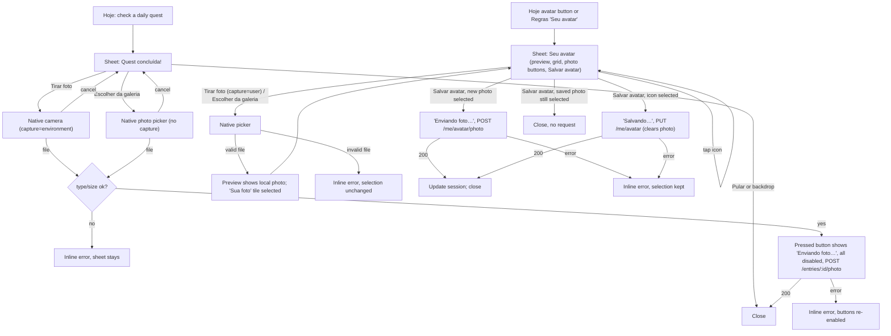

# Image upload flow: gallery picks for quest photos, avatar photos, and split Cloudinary folders

Status: Draft
Last updated: 2026-10-12
Depends on: [`quest-photo-uploads.md`](./quest-photo-uploads.md) (Done — entry photo upload, Cloudinary adapter) and [`profile-avatar.md`](./profile-avatar.md) (Done — `avatar_key`, "Seu avatar" sheet). Both are fully implemented on disk; this spec extends them and does not edit either file.

## Summary
Three changes to how images get into Boraquest. (1) After checking a quest, a member can **take a photo or pick one from the gallery**; today only the camera works. (2) A member can **upload a photo as their avatar** from the existing "Seu avatar" sheet, in addition to the six drawn icons. Every guild member then sees it wherever that member is shown. (3) Cloudinary storage is split into two directories, **`boraquest/entries/…`** for quest proof photos and **`boraquest/profile/…`** for avatar photos.

## Problem
- **Camera-only proof photos.** The hidden input on Hoje is `<input type="file" accept="image/*" capture="environment">` (`front-end/app/(tabs)/hoje/page.tsx:305-317`). `capture` makes Android and iOS open the camera directly, with no way to choose a photo already taken. A kid who photographed their tidy room an hour ago can't attach that photo.
- **Avatars are only six drawn icons.** `users.avatar_key` is a `CHECK`-constrained enum of six keys (`back-end/internal/src/infrastructure/postgres/migrations/0007_user_avatar.sql`). There's no way to use a real picture of yourself. Other members always see everyone else as the generic `DEFAULT_AVATAR` (`front-end/lib/avatars.ts:4`), because `GET /guild/members` returns only `{id, name}` (`back-end/internal/src/interface/http/controllers/guild_controller.go:22-25`).
- **One undifferentiated storage layout.** Entry photos go to `boraquest/<guildID>/entries/<entryID>` (`back-end/internal/src/infrastructure/cloudinary/uploader.go:29`). Avatar photos need their own place, and the user asked for two clearly separate directories, `entries` and `profile`.

## Goals
- On the "Quest concluída!" sheet, a member can either take a new photo or choose an existing one from the device. Both paths work on iOS Safari and on Chrome for Android 13, 14 and 15.
- A gallery pick of an iPhone HEIC photo reaches the API as JPEG. It is never rejected as "wrong type".
- A member can set an uploaded photo as their avatar and go back to a drawn icon at any time. The choice survives logout/login.
- Every screen that renders a real guild member (not sample data) shows that member's real avatar: their photo, else their picked icon.
- New entry photos land under `boraquest/entries/<guildID>/`. Avatar photos land under `boraquest/profile/<userID>/`.
- A replaced or abandoned avatar photo doesn't linger in Cloudinary (best-effort delete).
- `make lint` and `make cover` stay green at 100%.

## Non-goals
- **A client-side crop/zoom UI for avatars.** Cloudinary crops server-side to a 512×512 square with content-aware gravity (see Architecture). *Pending confirmation, see Open question 4.*
- **Changing any rule about entry photos.** They stay sum-only, same-day, once per entry, 8 MB, jpg/png/webp (`quest-photo-uploads.md` Business rules 1-5). Only the way the file is picked changes.
- **Moving existing entry photos in Cloudinary.** The DB stores each photo's full `secure_url` (`entries.photo_url`, `0008_entry_photos.sql`), so old assets keep working wherever they sit. *Pending confirmation, see Open question 2.*
- **Avatars on screens still driven by sample data.** `app/fim-de-semana/page.tsx` and Semana's "Anteriores" view (`app/(tabs)/semana/page.tsx:129-144`) still read `lib/data.ts` `members`. They are untouched here.
- **Removing your photo without picking an icon.** Going back to a drawn icon is how you remove the photo (Business rule 9). There's no separate "Remover foto" button.
- **Signed/authenticated Cloudinary delivery.** Delivery URLs stay public and unguessable, the same as entry photos (`quest-photo-uploads.md` Business rule 8).
- **Syncing your own avatar across devices without re-login.** See Edge cases.
- **An in-app camera (getUserMedia).** We only use the native file input.

## Current state
**Back-end**
- `back-end/internal/src/infrastructure/cloudinary/uploader.go`: `Uploader.Upload(ctx, guildID, entryID, file)` uploads with `PublicID: "boraquest/<guildID>/entries/<entryID>"`, `AssetFolder` set to that folder, `Overwrite`/`UniqueFilename` false and eager `w_1600,h_1600,c_limit,q_auto`. It returns the eager `secure_url` and the `public_id`. No delete method exists.
- `back-end/test/unit/cloudinary_uploader_test.go`: asserts the exact `public_id`/`asset_folder` strings above against a fake HTTP server (`client.Upload.Config.API.UploadPrefix`). These assertions change with the new layout.
- `back-end/internal/src/app/service/entry_service.go:47-51`: `PhotoUploader` interface. Lines 134-156: `AttachPhoto`, which validates via `entry.ValidPhotoFile` before uploading. No change needed beyond the adapter's folder.
- `back-end/internal/src/interface/http/controllers/entry_controller.go:121-142`: `UploadPhoto` applies `http.MaxBytesReader(MaxPhotoBytes + photoFormOverhead)`, reads `FormFile("photo")` and sniffs the first `sniffLen` (512) bytes with `http.DetectContentType`. The new avatar handler copies this pattern and reuses `photoFormOverhead`/`sniffLen` (same `controllers` package).
- `back-end/internal/src/domain/user/user.go`: `User{ID, Name, Email, PasswordHash, AvatarKey}`, `AvatarKeys`, `ValidAvatarKey`, `ErrInvalidAvatar`.
- `back-end/internal/src/infrastructure/postgres/user_repository.go`: `FindByEmail`, `ListByIDs` and `UpdateAvatar` all `SELECT … avatar_key`. **`ListByIDs` scans with `pgx.RowToStructByPos[user.User]` (line 54)**, so its `SELECT` column order must match the struct field order exactly.
- `back-end/internal/src/app/service/profile_service.go`: `ProfileRepository.UpdateAvatar(ctx, userID, avatarKey) (user.User, error)` and `ProfileService.UpdateAvatar`. `NewProfileService(profiles)` is the constructor today.
- `back-end/internal/src/interface/http/controllers/profile_controller.go`: `PUT /me/avatar` returns `UserResponse`. `auth_controller.go:26-31` defines `UserResponse{ID, Name, Email, AvatarKey}`. It is built inline in two places (`auth_controller.go:64`, `profile_controller.go:47`).
- `back-end/internal/src/app/service/guild_service.go`: `GuildMember{ID, Name}`, built from `ListByIDs`. `guild_controller.go`: `GuildMemberResponse{id, name}`.
- `back-end/cmd/webapp/routes/routes.go:33-34`: the `/me` group has only `PUT /avatar`.
- `back-end/cmd/webapp/main.go:55-65`: one `cloudinary.Uploader` (`photoUploader`) and one `UserRepository` are shared. `idgen.UUIDGenerator{}` already exists.
- `back-end/test/integration/main_test.go:155-164`: `fakePhotoStore` stands in for Cloudinary. `newServer` wires `NewProfileService(postgres.NewUserRepository(pool))`.
- Migrations on disk go up to `0008_entry_photos.sql`, so **the next free number is `0009`** (re-check at implementation time).
- `back-end/api/openapi.yaml`: `/me/avatar` (lines 42-64), `/entries/{id}/photo` (332-389), `User` (481-493), `GuildMember` (627-634).

**Front-end**
- `front-end/app/(tabs)/hoje/page.tsx:281-318`: the photo sheet has one primary "Adicionar foto" (camera icon), one plain "Pular", the hidden camera-only input, `photoBusy`/`photoError` state and `attachPhoto(file)` with the client type/size pre-check against `PHOTO_TYPES`/`PHOTO_MAX_BYTES` (`front-end/lib/api.ts:99-100`).
- `front-end/components/AvatarPickerSheet.tsx`: the "Seu avatar" sheet with a preview, a six-icon `.bq-avatar-grid`, an error note and "Salvar avatar"/"Salvando…". It is opened from Hoje's TopBar avatar button (`hoje/page.tsx:113-118`) and from Regras' "Seu avatar" small button (`regras/page.tsx:226-228`).
- `front-end/lib/avatars.ts`: `DEFAULT_AVATAR`, `AVATAR_KEYS`, `avatarSrc(key)`.
- `front-end/lib/auth.ts:5`: `SessionUser = { id, name, email, avatarKey }`, persisted in `localStorage` (`bq.session`).
- `front-end/lib/api.ts`: `apiFetchForm` (multipart POST helper, lines 47-60), `updateMyAvatar`, `GuildMember = { id, name }`.
- `front-end/components/ui.tsx:36-47`: `Avatar` renders `` inside `.bq-avatar`. `RankRow` (185-214) and `Banner` (289-299) take the same `member` shape.
- `front-end/app/globals.css:133-146`: `.bq-avatar img` is 100%×100% with **no clipping**. The drawn SVGs deliberately poke outside the circle (e.g. `public/avatars/lia.svg` has hair buns at the top corners of the 64×64 box), so a photo needs its own round clip.
- Where real guild members render with `DEFAULT_AVATAR` today:
  - `hoje/page.tsx:241` (slip banner) and `:328` (slip "Quem escorregou?" picker)
  - `guilda/page.tsx:84-88` (`toMember`; the caller uses the session avatar)
  - `auditoria/page.tsx:35`
  - `auditoria/revisar/page.tsx:34`
- No Next.js-specific APIs are involved. Every touched file is a `"use client"` component using `fetch` through `lib/api.ts`. Remote Cloudinary images are rendered with plain `` (no `next/image`, so no `images.remotePatterns` config), exactly as `semana/page.tsx:148` already does. No `node_modules/next/dist/docs/` guide is needed.

**External constraints (verified)**
- **Android:** on Chrome/Edge for Android 14 and 15, `<input type="file" accept="image/*">` *without* `capture` opens the system photo picker and no longer offers the camera. With `capture`, it opens only the camera. Older Android showed both. The dependable workaround is two inputs, one with `capture` and one without. Sources: [Addpipe: camera option missing on Android 14/15](https://blog.addpipe.com/html-file-input-accept-video-camera-option-is-missing-android-14-15.md), [Glide community: image picker lacks camera on Chrome Android 14](https://community.glideapps.com/t/image-picker-does-not-show-camera-option-in-chrome-android/74777).
- **iOS:** WebKit used to transcode HEIC to JPEG unconditionally on iOS. Since WebKit 275726 (March 2024) it transcodes only when `accept` lists specific image types that exclude HEIC. `accept="image/*"` therefore likely delivers `image/heic` from the Photos library, which our jpg/png/webp check rejects. Listing `image/jpeg,image/png,image/webp` explicitly makes Safari hand over a JPEG. Source: [WebKit bug 267277](https://bugs.webkit.org/show_bug.cgi?id=267277).
- **Cloudinary delete:** the Upload API's `destroy` takes `public_id` plus an optional `invalidate` (purges CDN copies) and returns `{"result":"ok"}`. The Upload API is documented as rate-unlimited (unlike the Admin API). Source: [Cloudinary destroy reference](https://cloudinary.com/documentation/image_upload_api_reference_destroy_by_public_id). In the Go SDK v2.16.1 (`back-end/go.mod`) this is `cld.Upload.Destroy(ctx, uploader.DestroyParams{PublicID, Invalidate *bool})`, which returns `*DestroyResult{Result string, Error api.ErrorResp}` (`uploader/edit_asset.go` in the module cache).
- **Cloudinary folders:** in dynamic-folder mode, moving an asset between folders in the Media Library does not change its public ID or delivery URL. In fixed-folder mode it does. Source: [Cloudinary folder modes](https://cloudinary.com/documentation/folder_modes). The adapter already sets both `public_id` (with path) and `asset_folder`, so the layout comes out right in either mode.
- **Automatic gravity (`g_auto`)** is available on the Free plan and prioritizes faces when cropping. Sources: [Cloudinary automatic gravity](https://cloudinary.com/documentation/image_automatic_gravity), [Cloudinary free-plan FAQ](https://cloudinary.com/documentation/developer_onboarding_faq_free_plan).

## User stories
- As a kid who already photographed their made bed, I want to attach that photo when I check the quest, so I don't have to make the bed look perfect a second time.
- As any guild member, I want to still be able to take a fresh photo right there, so proof stays one tap away.
- As any guild member, I want to use a real picture of myself (or my pet) as my avatar, so the scoreboard feels like *my* family.
- As any guild member, I want to see everyone else's real avatar on Guilda and in the slip picker, so I tap the right person.
- As any guild member, I want to switch back to a drawn icon whenever I like, so a photo is never a one-way door.

## UX flow



### Sheet: "Quest concluída!" on Hoje (changed)
- **Layout** (closest reference `design/components/TelaHoje`): burst icon, title, points and the "Quer guardar uma foto de prova? É opcional." line are unchanged. Below them the action stack now has **three block buttons**, all the same size:
  1. **"Tirar foto"**: primary (`<Button block icon="camera">`), the sheet's one primary action. Opens the camera input.
  2. **"Escolher da galeria"**: `variant="plain" block icon="image"`. Opens the gallery input.
  3. **"Pular"**: `variant="plain" block`, unchanged.
- **Inputs**: two hidden inputs owned by the new `PhotoSourceButtons` component (Architecture):
  - camera: `accept="image/*" capture="environment"`, identical to today's input
  - gallery: `accept="image/jpeg,image/png,image/webp"` with **no** `capture` (the explicit list makes iOS transcode HEIC to JPEG)

  Both reset `value` after `change`, as today (`hoje/page.tsx:313-314`).
- **States**:
  - **Default**: all three buttons enabled.
  - **Picker cancelled**: nothing happens and the sheet stays open (same as today).
  - **Invalid file**: inline `.bq-note role="alert"` with "Essa imagem não dá. Use jpg, png ou webp até 8 MB." No request is sent and the buttons stay enabled.
  - **Uploading**: all three buttons disabled. **The button the member used** reads "Enviando foto…"; the other keeps its label. The backdrop can't close the sheet (existing `closePhotoSheet` guard).
  - **Success**: the sheet closes and nothing is shown on Hoje (unchanged; the thumbnail is Semana-only per `quest-photo-uploads.md` Decision log #4).
  - **Error**: "Não deu para enviar a foto. Tenta de novo ou pula." Buttons re-enabled. The entry stays checked and scored.
  - **Offline**: same as Error (the fetch rejects).
- On desktop browsers `capture` is ignored, so both buttons open the same file dialog. That is acceptable.

### Sheet: "Seu avatar" (changed, `components/AvatarPickerSheet.tsx`)
- **Layout**, top to bottom:
  1. `h2.bq-title` "Seu avatar".
  2. A `size="lg"` preview of the current selection: a photo, round-clipped, or an icon.
  3. The `.bq-avatar-grid`: if the member has a photo (saved, or freshly picked in this sheet session), **a "Sua foto" tile comes first**, followed by the six icon tiles as today ("Avatar 1"…"Avatar 6"). With no photo the grid is exactly today's six tiles.
  4. `span.bq-label` "Ou use uma foto sua".
  5. A `bq-row` of two small buttons, `Button variant="small" icon="camera"` "Tirar foto" and `Button variant="small" icon="image"` "Escolher da galeria", rendered by `PhotoSourceButtons` with `facing="user"` (front camera).
  6. The error note.
  7. The primary `Button block` "Salvar avatar", the sheet's one primary action.
- **States**:
  - **Open, member has a saved photo**: "Sua foto" tile pre-selected and the preview shows it.
  - **Open, no photo**: their `avatarKey` icon pre-selected (today's behavior).
  - **Picked a valid file**: the sheet creates a local preview (`URL.createObjectURL`). The "Sua foto" tile now shows that preview (replacing any saved photo tile) and is selected. **Nothing is uploaded yet**, matching every other sheet in the app (save on the primary button only).
  - **Picked an invalid file**: inline "Essa imagem não dá. Use jpg, png ou webp até 8 MB."; the selection and preview are unchanged.
  - **Tapped an icon**: that icon is selected and the "Sua foto" tile stays visible but unselected, so the member can go back to it without re-picking.
  - **Saving, new photo**: all controls disabled; the primary reads "Enviando foto…"; `POST /me/avatar/photo`.
  - **Saving, icon**: primary reads "Salvando…"; `PUT /me/avatar` (as today).
  - **Saving, the already-saved photo still selected**: no request; the sheet just closes.
  - **Success**: the session's `user.avatarKey` and `user.avatarUrl` are updated from the response (`setSession`), the sheet closes, and the preview object URL is revoked.
  - **Error / offline**: "Não deu para salvar. Tenta de novo."; the sheet stays open with the selection and picked file kept.
  - **Discard** (backdrop while idle): the sheet closes, nothing is sent and the object URL is revoked.

### Everywhere a real guild member is shown (changed rendering only)
| Screen | Who | Source of the avatar |
| --- | --- | --- |
| Hoje TopBar avatar button (`hoje/page.tsx:112`) | caller | session |
| Hoje slip banner (`:241`) | the slipped member | `GET /guild/members` (session if it's the caller) |
| Hoje slip picker (`:328`) | every member | same |
| Guilda ranking rows and the ask-audit sheet (`guilda/page.tsx:84-88`) | every member | same |
| Auditoria banner (`auditoria/page.tsx:35`) | requester | `GET /guild/members` |
| Auditoria revisar (`auditoria/revisar/page.tsx:34`) | audited member | `GET /guild/members` |

Resolution order for any member: `avatarUrl` (photo), then `avatarKey` (icon), then `DEFAULT_AVATAR` (Business rule 8).

## Copy (pt-BR)
| Key / location | Text |
| --- | --- |
| Hoje photo sheet, camera button | Tirar foto |
| Hoje photo sheet, gallery button | Escolher da galeria |
| Hoje photo sheet, skip (unchanged) | Pular |
| Hoje photo sheet, busy label on the pressed button (unchanged text) | Enviando foto… |
| Hoje photo sheet, invalid file (unchanged) | Essa imagem não dá. Use jpg, png ou webp até 8 MB. |
| Hoje photo sheet, upload failed (unchanged) | Não deu para enviar a foto. Tenta de novo ou pula. |
| Avatar sheet, label above photo buttons | Ou use uma foto sua |
| Avatar sheet, camera button | Tirar foto |
| Avatar sheet, gallery button | Escolher da galeria |
| Avatar sheet, photo tile `aria-label` (and preview `alt` when a photo is selected) | Sua foto |
| Avatar sheet, primary idle (unchanged) | Salvar avatar |
| Avatar sheet, primary busy saving an icon (unchanged) | Salvando… |
| Avatar sheet, primary busy uploading a photo | Enviando foto… |
| Avatar sheet, invalid file | Essa imagem não dá. Use jpg, png ou webp até 8 MB. |
| Avatar sheet, save failed (unchanged) | Não deu para salvar. Tenta de novo. |
| `design/BRAND.md` "Rules of the game", line 67 | A photo after checking a quest is optional. "Tirar foto", "Escolher da galeria" and "Pular" are the same size. |

## Business rules
1. **Two sources, same entry-photo rules.** On the quest sheet, "Tirar foto" opens the camera and "Escolher da galeria" opens the device's photo picker. Every existing rule from `quest-photo-uploads.md` (Business rules 1-8) applies unchanged, whatever the source.
2. **The gallery input accepts exactly `image/jpeg,image/png,image/webp`**, so iOS transcodes HEIC to JPEG. The camera input keeps `accept="image/*" capture=…`.
3. **New entry photos are stored at public ID `boraquest/entries/<guildID>/<entryID>`, asset folder `boraquest/entries/<guildID>`.**
4. **Avatar photos are stored at public ID `boraquest/profile/<userID>/<avatarID>`, asset folder `boraquest/profile/<userID>`.** `avatarID` is a fresh UUID per upload, so the URL changes on every replace (no stale CDN or browser cache) and can't be guessed from the user id.
5. **Existing entry photos are not moved.** Their stored `photo_url`/`photo_public_id` keep working unchanged.
6. **A member can only set their own avatar photo.** The endpoint takes no target id and acts on `middleware.UserID(c)`.
7. **Avatar photo file limits match entry photos**: `image/jpeg`, `image/png` or `image/webp` detected from the bytes (not the client header), size 1 byte to 8 MB. The client pre-checks with the same constants; the server is the real enforcement.
8. **Display precedence**: a non-empty `avatarUrl` shows the photo. Otherwise `avatarKey` shows that icon. Otherwise (unknown member) `DEFAULT_AVATAR`.
9. **Saving an icon clears the photo.** `PUT /me/avatar` sets `avatar_key` and resets `avatar_url`/`avatar_public_id` to `''`. Uploading a photo leaves `avatar_key` unchanged.
10. **Replaced or cleared avatar photos are deleted from Cloudinary, best-effort, after the DB update commits.** A failed delete never fails the request; it is logged and the asset is orphaned. *Pending confirmation, see Open question 5.*
11. **If the DB update fails after a successful avatar upload**, the just-uploaded asset is deleted best-effort and the request fails with 500.
12. **`GET /guild/members` exposes `avatarKey` and `avatarUrl` for every member of the caller's guild.** It already exposes their `id`/`name`; avatars are guild-visible, like names.
13. **Avatar photos are cropped server-side** to a 512×512 square with eager transformation `c_fill,g_auto,w_512,h_512,q_auto`, and rendered round-clipped. There is no client crop.

## Data model

### Back-end, `back-end/internal/src/domain/user/user.go` (additions)
```go
// MaxAvatarBytes is the largest avatar photo accepted (same limit as entry photos).
const MaxAvatarBytes = 8 << 20

// AllowedAvatarTypes lists the sniffed content types an avatar photo may have.
var AllowedAvatarTypes = []string{"image/jpeg", "image/png", "image/webp"}

var ErrInvalidAvatarPhoto = errors.New("user: avatar photo must be jpg, png or webp, up to 8MB")

// ValidAvatarFile reports whether contentType and size are acceptable for an avatar photo.
func ValidAvatarFile(contentType string, size int64) bool {
	return slices.Contains(AllowedAvatarTypes, contentType) && size > 0 && size <= MaxAvatarBytes
}

type User struct {
	ID             string
	Name           string
	Email          string
	PasswordHash   string
	AvatarKey      string // always one of AvatarKeys; kept when a photo is set
	AvatarURL      string // new: delivery URL of the avatar photo; "" = no photo
	AvatarPublicID string // new: storage-side id of that photo; "" = no photo
}
```
Invariant: `AvatarURL == ""` if and only if `AvatarPublicID == ""`. **Field order matters**: `ListByIDs` uses `pgx.RowToStructByPos`, so every `SELECT` lists `id, name, email, password_hash, avatar_key, avatar_url, avatar_public_id` in this order.

The entry and user limits are duplicated on purpose (two tiny constants). `domain/user` must not import `domain/entry`.

### Postgres: `back-end/internal/src/infrastructure/postgres/migrations/0009_user_avatar_photo.sql` (next free number, re-check)
```sql
-- +goose Up
ALTER TABLE users ADD COLUMN avatar_url TEXT NOT NULL DEFAULT '';
ALTER TABLE users ADD COLUMN avatar_public_id TEXT NOT NULL DEFAULT '';

-- +goose Down
ALTER TABLE users DROP COLUMN avatar_public_id;
ALTER TABLE users DROP COLUMN avatar_url;
```
This is an expand-only migration. The running release selects explicit column lists (`user_repository.go:36,50,61`), so it ignores the new columns. There is no contract step.

### Front-end
```ts
// front-end/lib/auth.ts
export type SessionUser = { id: string; name: string; email: string; avatarKey: string; avatarUrl?: string };
// avatarUrl is optional because sessions saved before this change don't have it; read it as `?? ""`.

// front-end/lib/api.ts
export type User = { id: string; name: string; email: string; avatarKey: string; avatarUrl: string };
export type GuildMember = { id: string; name: string; avatarKey: string; avatarUrl: string }; // + avatarKey, avatarUrl
export const updateMyAvatar = (avatarKey: string) => apiFetch<User>("/me/avatar", "PUT", { avatarKey }); // return type now User
export const uploadMyAvatarPhoto = (file: File) => {
  const form = new FormData();
  form.append("photo", file);
  return apiFetchForm<User>("/me/avatar/photo", form);
};
// Gallery input accept value, derived from PHOTO_TYPES (lib/api.ts:99): "image/jpeg,image/png,image/webp"
export const PHOTO_ACCEPT = PHOTO_TYPES.join(",");

// front-end/lib/avatars.ts — addition
export type AvatarSource = { avatarKey?: string; avatarUrl?: string };
/** What <Avatar> renders for someone: their photo, else their icon, else the generic default (Business rule 8). */
export function avatarFor(src: AvatarSource | undefined): { avatar: string; photo: boolean } {
  if (src?.avatarUrl) return { avatar: src.avatarUrl, photo: true };
  if (src?.avatarKey) return { avatar: avatarSrc(src.avatarKey), photo: false };
  return { avatar: DEFAULT_AVATAR, photo: false };
}
```
Update the `DEFAULT_AVATAR` comment in `lib/avatars.ts:1-3`: it is now only the fallback for an unknown member. `lib/data.ts` is unchanged.

## Architecture & technical decisions

### Back-end layering
| Layer | File | Change |
| --- | --- | --- |
| Domain | `internal/src/domain/user/user.go` | Data model additions above. |
| App | `internal/src/app/service/profile_service.go` | Change `ProfileRepository`; add the `AvatarStore` interface and `UploadAvatarPhoto`; `UpdateAvatar` deletes the previous photo. The constructor becomes `NewProfileService(profiles ProfileRepository, store AvatarStore, ids IDGenerator)` (`IDGenerator` is the existing interface from `rule_service.go`). |
| App | `internal/src/app/service/guild_service.go` | `GuildMember` gains `AvatarKey`, `AvatarURL`, copied from `user.User`. |
| Infra | `internal/src/infrastructure/postgres/user_repository.go` | Add the two columns to every `SELECT`/`RETURNING`/`Scan`. Change `UpdateAvatar` and add `SetAvatarPhoto` (SQL below). |
| Infra | `internal/src/infrastructure/postgres/migrations/0009_user_avatar_photo.sql` | New (above). |
| Infra | `internal/src/infrastructure/cloudinary/uploader.go` | New entry folder; add `UploadAvatar` and `DeleteAvatar`; extract a private `upload` helper (below). Update the package doc ("stores entry photos" becomes "stores entry and avatar photos"). |
| Interface | `internal/src/interface/http/controllers/auth_controller.go` | `UserResponse` gains `AvatarURL string \`json:"avatarUrl"\``. Add `toUserResponse(u user.User) UserResponse` and use it in `Login`. |
| Interface | `internal/src/interface/http/controllers/profile_controller.go` | Add `UploadAvatarPhoto` to `ProfileUseCase` and a handler; `UpdateAvatar` uses `toUserResponse`; `writeProfileError` maps `ErrInvalidAvatarPhoto` to 400. |
| Interface | `internal/src/interface/http/controllers/guild_controller.go` | `GuildMemberResponse` gains `avatarKey`, `avatarUrl`. |
| Routes | `cmd/webapp/routes/routes.go` | `me.POST("/avatar/photo", c.Profile.UploadAvatarPhoto)`. |
| Wiring | `cmd/webapp/main.go` | `service.NewProfileService(userRepository, photoUploader, idgen.UUIDGenerator{})`. **The same `*cloudinary.Uploader` satisfies both `service.PhotoUploader` and `service.AvatarStore`.** This mirrors `UserRepository` satisfying several repository interfaces. |

### App service (`profile_service.go`)
```go
// ProfileRepository persists a member's own profile settings.
type ProfileRepository interface {
	// UpdateAvatar sets avatar_key, clears any avatar photo, and returns the updated
	// user plus the public id of the photo it cleared ("" if there was none).
	// Returns user.ErrNotFound if userID doesn't exist.
	UpdateAvatar(ctx context.Context, userID, avatarKey string) (u user.User, previousPublicID string, err error)
	// SetAvatarPhoto stores url/publicID as userID's avatar photo and returns the
	// updated user plus the public id of the photo it replaced ("" if none).
	// Returns user.ErrNotFound if userID doesn't exist.
	SetAvatarPhoto(ctx context.Context, userID, url, publicID string) (u user.User, previousPublicID string, err error)
}

// AvatarStore stores avatar photos in external storage.
type AvatarStore interface {
	// UploadAvatar stores file under userID/avatarID and returns its delivery URL and storage id.
	UploadAvatar(ctx context.Context, userID, avatarID string, file io.Reader) (url, storedID string, err error)
	// DeleteAvatar permanently removes a stored avatar. Deleting an id that no longer exists is not an error.
	DeleteAvatar(ctx context.Context, storedID string) error
}

func (s *ProfileService) UpdateAvatar(ctx context.Context, callerID, avatarKey string) (user.User, error) {
	if !user.ValidAvatarKey(avatarKey) {
		return user.User{}, user.ErrInvalidAvatar
	}
	u, previous, err := s.profiles.UpdateAvatar(ctx, callerID, avatarKey)
	if err != nil {
		return user.User{}, err
	}
	s.discard(ctx, previous)
	return u, nil
}

// UploadAvatarPhoto validates file and makes it callerID's avatar. contentType must
// be the sniffed type of file's bytes, size its length.
func (s *ProfileService) UploadAvatarPhoto(ctx context.Context, callerID, contentType string, size int64, file io.Reader) (user.User, error) {
	if !user.ValidAvatarFile(contentType, size) {
		return user.User{}, user.ErrInvalidAvatarPhoto
	}
	url, storedID, err := s.store.UploadAvatar(ctx, callerID, s.ids.NewID(), file)
	if err != nil {
		return user.User{}, err
	}
	u, previous, err := s.profiles.SetAvatarPhoto(ctx, callerID, url, storedID)
	if err != nil {
		s.discard(ctx, storedID) // don't orphan the asset we just uploaded (Business rule 11)
		return user.User{}, err
	}
	s.discard(ctx, previous)
	return u, nil
}

// discard deletes a no-longer-referenced avatar, best-effort (Business rule 10).
// Failures are logged by the adapter and otherwise ignored.
func (s *ProfileService) discard(ctx context.Context, storedID string) {
	if storedID != "" {
		_ = s.store.DeleteAvatar(ctx, storedID)
	}
}
```
The delete runs synchronously after the DB write. That adds one Cloudinary round trip to a rare action, but avoids goroutines that would make the 100%-coverage tests nondeterministic.

### Postgres (`user_repository.go`)
Both writes return the *previous* public id atomically. The `FROM (… FOR UPDATE)` sub-select locks the row, so two concurrent uploads serialize and the second sees the first's id as "previous". **Do not use PostgreSQL 18's `RETURNING OLD.*`**: the integration suite runs `postgres:17-alpine` (`test/integration/main_test.go:47`).
```sql
-- UpdateAvatar($1 = avatarKey, $2 = userID)
UPDATE users u SET avatar_key = $1, avatar_url = '', avatar_public_id = ''
FROM (SELECT id, avatar_public_id FROM users WHERE id = $2 FOR UPDATE) prev
WHERE u.id = prev.id
RETURNING u.id, u.name, u.email, u.password_hash, u.avatar_key, u.avatar_url, u.avatar_public_id, prev.avatar_public_id

-- SetAvatarPhoto($1 = url, $2 = publicID, $3 = userID)
UPDATE users u SET avatar_url = $1, avatar_public_id = $2
FROM (SELECT id, avatar_public_id FROM users WHERE id = $3 FOR UPDATE) prev
WHERE u.id = prev.id
RETURNING u.id, u.name, u.email, u.password_hash, u.avatar_key, u.avatar_url, u.avatar_public_id, prev.avatar_public_id
```
Zero rows (`pgx.ErrNoRows`) maps to `user.ErrNotFound`, as `UpdateAvatar` does today.

### Cloudinary adapter (`uploader.go`)
```go
const (
	rootFolder           = "boraquest"
	entryTransformation  = "w_1600,h_1600,c_limit,q_auto"     // renamed from deliveryTransformation, same value
	avatarTransformation = "c_fill,g_auto,w_512,h_512,q_auto" // square, face/subject-aware (Business rule 13)
)

// Upload stores an entry photo as boraquest/entries/<guildID>/<entryID>.
func (u *Uploader) Upload(ctx context.Context, guildID, entryID string, file io.Reader) (string, string, error) {
	return u.upload(ctx, rootFolder+"/entries/"+guildID, entryID, entryTransformation, file)
}

// UploadAvatar stores an avatar photo as boraquest/profile/<userID>/<avatarID>.
func (u *Uploader) UploadAvatar(ctx context.Context, userID, avatarID string, file io.Reader) (string, string, error) {
	return u.upload(ctx, rootFolder+"/profile/"+userID, avatarID, avatarTransformation, file)
}

// upload is today's Upload body, parameterized: PublicID folder+"/"+name, AssetFolder folder,
// Overwrite/UniqueFilename false, Eager eager; same error handling and eager-URL fallback.

// DeleteAvatar destroys storedID and purges its CDN copies. "ok" and "not found" both
// count as success; anything else is logged and returned.
func (u *Uploader) DeleteAvatar(ctx context.Context, storedID string) error {
	res, err := u.client.Upload.Destroy(ctx, uploader.DestroyParams{PublicID: storedID, Invalidate: new(true)})
	switch {
	case err != nil:
	case res.Error.Message != "":
		err = errors.New("cloudinary: " + res.Error.Message)
	case res.Result != "ok" && res.Result != "not found":
		err = errors.New("cloudinary: destroy returned " + res.Result)
	}
	if err != nil {
		log.Printf("cloudinary: delete avatar %s: %v", storedID, err)
	}
	return err
}
```

### Controller (`profile_controller.go`)
`UploadAvatarPhoto` is a copy of `EntryController.UploadPhoto`'s parsing:
1. `http.MaxBytesReader(user.MaxAvatarBytes + photoFormOverhead)`.
2. `FormFile("photo")`; if that fails, 400 `"a photo file (jpg, png or webp, up to 8MB) is required"`.
3. Sniff 512 bytes and re-join them with `io.MultiReader`.
4. Call `UploadAvatarPhoto(ctx, UserID(c), contentType, header.Size, body)`, then return 200 with `toUserResponse(u)`.

`writeProfileError` gains `user.ErrInvalidAvatarPhoto` → 400 (`err.Error()`). Upload or storage failures fall through to the existing 500 default.

### Front-end
- **New `front-end/components/PhotoSourceButtons.tsx`** (`"use client"`), the only place that knows the two-input pattern:
  ```tsx
  type Source = "camera" | "gallery";
  export function PhotoSourceButtons({ size, facing, busySource, disabled, onPick }: {
    size: "block" | "small";            // block: camera = primary block, gallery = plain block. small: both variant="small".
    facing: "environment" | "user";     // capture value for the camera input
    busySource?: Source | null;         // that button reads "Enviando foto…"
    disabled?: boolean;
    onPick: (file: File, source: Source) => void;
  })
  ```
  It renders the two buttons (icons `camera` and `image`, copy per table) and two hidden inputs:
  - camera: `accept="image/*" capture={facing}`
  - gallery: `accept={PHOTO_ACCEPT}`, no `capture`

  Each `onChange` reads `files?.[0]`, resets `e.target.value = ""` and calls `onPick` only when a file exists. The component does **not** validate; callers keep their own checks and error copy. It returns a fragment, so the caller controls layout: inside the existing `.bq-stack` on Hoje, inside a `.bq-row` in the avatar sheet.
- **`app/(tabs)/hoje/page.tsx`**:
  - Replace the `Adicionar foto` button and the `fileInput` ref/input with `<PhotoSourceButtons size="block" facing="environment" busySource={photoSource} disabled={photoBusy} onPick={attachPhoto} />`, followed by the unchanged "Pular".
  - Add state `photoSource: "camera" | "gallery" | null`, set when an upload starts and cleared in `finally`. `attachPhoto(file, source)` keeps its body.
  - Render members with `avatarFor`: `const avatarOf = (id: string) => avatarFor(id === me ? session.user : memberById.get(id))`. Use it in the TopBar (`meAvatarMember`), the slip banner and the slip picker.
- **`components/AvatarPickerSheet.tsx`**:
  - New state: `photo: { url: string; file?: File } | null`, initialized from `session.user.avatarUrl`. A present `file` means picked but not uploaded.
  - `selection: "photo" | string`, initialized to `"photo"` if `session.user.avatarUrl` is non-empty, else `session.user.avatarKey`.
  - On pick:
    1. Validate against `PHOTO_TYPES`/`PHOTO_MAX_BYTES`.
    2. Revoke any previous object URL.
    3. Set `photo = { url: URL.createObjectURL(file), file }` and `selection = "photo"`.
  - Revoke the object URL on unmount (`useEffect` cleanup).
  - Save branches exactly as in UX flow. On success: `setSession({ ...session, user: { ...session.user, avatarKey: u.avatarKey, avatarUrl: u.avatarUrl } })`.
- **`components/ui.tsx`**:
  - `Avatar`'s `member` type becomes `{ id: string; name: string; avatar: string; photo?: boolean }` and adds `photo && "bq-avatar--photo"` to the class list.
  - Widen `RankRow`'s and `Banner`'s `member` types the same way (they pass `member` straight to `Avatar`).
  - All existing callers stay valid (`photo` is optional).
- **`app/globals.css`**: after line 146, add `.bq-avatar--photo img{border-radius:50%;object-fit:cover;background:var(--surface-sunken)}`. Do **not** clip the drawn SVGs (they extend past the circle).
- **`app/(tabs)/guilda/page.tsx`**: `toMember(id)` returns `{ id, name, ...avatarFor(id === callerId ? session?.user : memberById.get(id)) }`.
- **`app/auditoria/page.tsx`, `app/auditoria/revisar/page.tsx`**: build `requesterView`/`auditedView` with `...avatarFor(requester)` / `...avatarFor(audited)`.
- **`design/BRAND.md`** line 67: update per the Copy table. This is the one design-doc change, kept so the doc doesn't contradict the sheet.

## API / contracts

### `POST /api/v1/me/avatar/photo` (new)
- **Auth**: required. Body: `multipart/form-data` with one file field `photo`.
- **200**: `User` = `{ id, name, email, avatarKey, avatarUrl }`, where `avatarUrl` is the 512×512 eager delivery URL.
- **400**: no `photo` field; or the sniffed type isn't jpg/png/webp, or the size is 0 or over 8 MB (`user.ErrInvalidAvatarPhoto`); or the body exceeds 9 MB (the `MaxBytesReader` makes `FormFile` fail, which is also 400).
- **401**: missing or invalid token.
- **404**: caller's user row is gone (defensive, `user.ErrNotFound`).
- **500**: Cloudinary upload failed, or the DB write failed (the uploaded asset is then deleted best-effort).

### `PUT /api/v1/me/avatar` (changed behavior, same request)
- Also clears `avatarUrl`. The response `User` now carries `avatarUrl: ""`. The previous photo, if any, is deleted best-effort. Status codes are unchanged.

### `POST /api/v1/auth/login` (changed response)
- `user` gains `avatarUrl` (`""` when there's no photo).

### `GET /api/v1/guild/members` (changed response)
```json
{ "members": [ { "id": "lia", "name": "Lia", "avatarKey": "duda", "avatarUrl": "https://res.cloudinary.com/<cloud>/image/upload/c_fill,g_auto,w_512,h_512,q_auto/v1/boraquest/profile/lia/<uuid>.jpg" } ] }
```

### `POST /api/v1/entries/{id}/photo`
- Contract unchanged. Only the storage path behind it changes (Business rule 3).

### `back-end/api/openapi.yaml`
- Add the `/me/avatar/photo` path, modeled on `/entries/{id}/photo` (multipart `photo`, `bearerAuth`, the responses above).
- Add `avatarUrl` (string, required, "Delivery URL of the avatar photo; empty string when there is none") to `User`.
- Add `avatarKey` (same enum as `User`) and `avatarUrl` (both required) to `GuildMember`.
- Update the `/me/avatar` summary to "Set the caller's own avatar icon (clears any avatar photo)".

## Edge cases
| Case | Expected behavior |
| --- | --- |
| iPhone, gallery pick of a HEIC photo | Safari transcodes to JPEG because of the explicit `accept` list (Business rule 2), and the upload succeeds. If a device still sends HEIC, the client shows the "Essa imagem não dá…" message (no request). |
| Chrome for Android 14/15 | "Tirar foto" opens the camera and "Escolher da galeria" opens the photo picker. Each works independently. |
| Desktop browser | Both buttons open the OS file dialog (capture ignored). Works. |
| Member cancels the native picker | Nothing changes; the sheet stays open. |
| Double tap on "Tirar foto"/"Escolher da galeria" while uploading | Buttons are disabled while `photoBusy`; no second request. |
| Avatar: pick a photo, then tap an icon, then save | `PUT /me/avatar` with the icon; nothing uploaded; the object URL is revoked on close. |
| Avatar: pick a photo, tap backdrop | Nothing sent; the saved avatar is unchanged; the object URL is revoked. |
| Avatar: saved photo selected, member taps "Salvar avatar" without changes | No request; the sheet closes. |
| Avatar: two devices upload at the same time | Row lock serializes them. Last write wins, and the loser's asset becomes "previous" and is deleted. No orphan. |
| Avatar: Cloudinary delete fails (network, bad credentials) | The request still succeeds. The adapter logs `cloudinary: delete avatar <id>: <err>` and the asset is orphaned (accepted). |
| Avatar: DB update fails after upload | 500. The just-uploaded asset is deleted best-effort. The client shows "Não deu para salvar. Tenta de novo." |
| Session saved before this release (no `avatarUrl` in localStorage) | Read as `""`, so the icon renders. The next login stores `avatarUrl`. |
| Member changed avatar on another device | Their own avatar on this device (session) stays stale until re-login or until they save again here. Everyone else's avatars come fresh from `GET /guild/members` on every page load. Accepted (Non-goals). |
| Cloudinary photo URL fails to load (deleted asset, offline) | The `` shows the `--surface-sunken` disc background. No crash. |
| Existing entry photos under `boraquest/<guildID>/entries/` | Still display (stored full URL). Optionally the maintainer can move them in the Media Library; in dynamic-folder mode the URL doesn't change (see Current state). Not required. |
| Member with no guild calls `POST /me/avatar/photo` | Allowed: avatars are per-user, not guild-scoped. The rest of the app 403s them anyway. |
| Body over 9 MB | `MaxBytesReader` cuts it off, `FormFile` errors, and the API returns 400. The client pre-check prevents this in normal use. |

## Accessibility, privacy & performance
- **Accessibility**:
  - Every new button is ≥48px: block buttons are 56px, `variant="small"` is 48px (`--tap-min`).
  - The "Sua foto" tile is a `.bq-pick` button with `aria-label="Sua foto"` and `aria-pressed`. Selection is shown by the existing `bq-avatar--selected` ring plus `aria-pressed`, not color alone.
  - Avatar `` stays the member's name (existing `Avatar` behavior).
  - The busy label change ("Enviando foto…") is visible text on the pressed button.
  - No new motion.
- **Privacy**:
  - Avatar photos may show minors' faces and are visible to the whole guild by design (Business rule 12).
  - Delivery URLs are public but contain a random UUID (Business rule 4), and the API returns them only to authenticated guild members.
  - Replaced and cleared photos are deleted (Business rule 10), so the household doesn't silently accumulate old face photos.
  - There is still no account-deletion flow (`quest-photo-uploads.md` Non-goals), so the current avatar photo lives until replaced.
- **Performance**:
  - Avatar photos are served as the 512×512 `q_auto` eager variant (tens of KB) and rendered at 32-72px. That's acceptable; no per-size URLs.
  - Each avatar save costs one upload, one eager transformation and at most one destroy. That's negligible against the Free plan's 25 monthly credits (`quest-photo-uploads.md` Current state).
  - No polling.

## Decision log
| # | Decision | Rationale | Alternatives rejected |
| --- | --- | --- | --- |
| 1 | Two explicit buttons/inputs ("Tirar foto" with `capture`, "Escolher da galeria" without) *(recommended, pending Open question 3)* | Chrome for Android 14/15 drops the camera from a capture-less `image/*` picker. Only two inputs give both paths reliably on Android and iOS. | One "Adicionar foto" input without `capture`: on iOS it shows a Library/Camera menu, but on modern Android the camera disappears. `accept="image/*,text/plain"` hack: lets any file through and depends on undocumented behavior. |
| 2 | Gallery input uses `accept="image/jpeg,image/png,image/webp"` | Since WebKit 275726, iOS transcodes HEIC to JPEG only when the accept list is restricted and excludes HEIC. Without that, iPhone gallery picks would be rejected. | Accept HEIC server-side and convert. That needs Cloudinary format conversion plus validation changes, for a problem the browser solves for free. |
| 3 | Folder layout `boraquest/entries/<guildID>/<entryID>` and `boraquest/profile/<userID>/<uuid>` *(recommended, pending Open question 1)* | Gives the two sibling top-level directories the user asked for. Avatars are per-user, not per-guild. The `boraquest/` root keeps the Cloudinary account tidy if it ever hosts anything else. | Keep `boraquest/<guildID>/entries` and add `boraquest/<guildID>/profile`: no path change for entries, but it ties a per-user asset to a guild and scatters "profile" across guild folders. |
| 4 | No migration of existing entry photos *(recommended, pending Open question 2)* | The DB stores full URLs, so old assets keep working. Production likely has few or none (`ci-cd-deploy.md` setup still pending). A scripted rename would have to rewrite `photo_url` too. | A one-off rename script plus DB update: real risk of broken URLs for a cosmetic gain. |
| 5 | The avatar photo lives on `users` as `avatar_url`/`avatar_public_id`; `avatar_key` is kept | Mirrors the `entries.photo_url`/`photo_public_id` pattern. Keeping the key leaves the `CHECK` constraint untouched and gives a fallback icon. | Widen `avatar_key` to hold URLs: breaks the `CHECK` constraint and mixes two concepts in one column. A separate `avatars` table: no second avatar per user to justify it. |
| 6 | Saving an icon clears the photo; there's no separate "remove photo" | One rule, one primary button. Going back is "pick an icon, save". | A "Remover foto" button: a second destructive action in a small sheet, for the same outcome. |
| 7 | Delete the old avatar photo after replace/clear, best-effort and synchronous *(recommended, pending Open question 5)* | Avoids accumulating face photos of family members (privacy). Synchronous keeps tests deterministic at 100% coverage. | Keep every old photo: zero code, but grows storage and keeps old faces public at unguessable URLs. Async goroutine delete: faster response, but flaky tests and lost errors. |
| 8 | Server-side square crop `c_fill,g_auto,w_512,h_512,q_auto`, no client crop UI *(recommended, pending Open question 4)* | `g_auto` prioritizes faces and works on the Free plan. A crop UI is a new interaction plus a dependency, with no BRAND precedent. | An in-app crop/zoom step: better control, but a sizeable UI plus a library; a later follow-up if auto-crop disappoints. |
| 9 | Show real avatars for every guild member (`GET /guild/members` gains `avatarKey`/`avatarUrl`) *(recommended, pending Open question 6)* | "Display it where users are shown" is the user's ask, and a photo avatar no one else sees has little value. This closes `profile-avatar.md`'s follow-up. | Own avatar only (status quo): every other member still shows the generic icon. |
| 10 | One `cloudinary.Uploader` implements both `service.PhotoUploader` and `service.AvatarStore` | Interfaces live in the layer that uses them (CLAUDE.md), with one concrete adapter and one client. The same pattern as `UserRepository`. | Two adapter structs: duplicate client wiring for no gain. |
| 11 | Avatar file limits duplicated in `domain/user` rather than shared with `domain/entry` | Avoids a `user` to `entry` domain import for two constants. | A new shared `domain/image` package: refactor scope beyond this spec. |

## Implementation plan
Back-end steps 1-9 run in order. Front-end steps 10-15 can start once step 8's shapes are fixed (they can be stubbed earlier); steps 12-14 can run in parallel.

1. **Domain**: add `MaxAvatarBytes`, `AllowedAvatarTypes`, `ErrInvalidAvatarPhoto`, `ValidAvatarFile` and the `AvatarURL`/`AvatarPublicID` fields to `back-end/internal/src/domain/user/user.go`. Done when it builds and `test/unit/user_test.go` covers `ValidAvatarFile`: each allowed type at exactly 8 MB passes; 8 MB + 1, size 0, negative and `image/gif`/`image/heic` all fail.
2. **Migration**: `back-end/internal/src/infrastructure/postgres/migrations/0009_user_avatar_photo.sql` (re-check the number). Done when `make db-up && make run` boots and `SELECT avatar_url, avatar_public_id FROM users` returns `''` for every seeded user.
3. **Repository**:
   - In `user_repository.go`, extend the column lists and `Scan`s of `FindByEmail`, `ListByIDs` and `UpdateAvatar` in struct order.
   - Change `UpdateAvatar` to the SQL above, returning `(user.User, string, error)`.
   - Add `SetAvatarPhoto`.

   Done when the integration tests in step 9 pass.
4. **Cloudinary adapter**:
   - In `uploader.go`, extract `upload` and switch `Upload` to `boraquest/entries/<guildID>`.
   - Add `UploadAvatar` and `DeleteAvatar` per Architecture.
   - Update `test/unit/cloudinary_uploader_test.go` (see Test plan). Done when that file passes with 100% coverage of `uploader.go`.
5. **App services**:
   - `profile_service.go`: new interfaces, constructor, `UploadAvatarPhoto`, the updated `UpdateAvatar`, `discard`.
   - `guild_service.go`: `GuildMember` fields.
   - Update the fakes in `test/unit/profile_service_test.go` and `guild_service_test.go`.
6. **Controllers**:
   - `auth_controller.go`: `AvatarURL` and `toUserResponse`.
   - `profile_controller.go`: `UploadAvatarPhoto` and the error mapping.
   - `guild_controller.go`: the new response fields.
7. **Routes and wiring**:
   - `routes.go`: `me.POST("/avatar/photo", …)`.
   - `main.go`: the new `NewProfileService` arguments.
   - `test/integration/main_test.go`: update `newServer`, and make the fake store a per-server pointer that records `UploadAvatar`/`DeleteAvatar` calls (mutex-guarded) and returns `https://photos.test/boraquest/profile/<userID>/<avatarID>.jpg`. Also update `fakePhotoStore.Upload`'s id string to the new `boraquest/entries/<guildID>/<entryID>` layout.
8. **OpenAPI**: `back-end/api/openapi.yaml` per API / contracts.
9. **Back-end tests to 100%** (list in Test plan). Done when `make lint && make cover` pass.
10. **Front-end types and client**:
    - `lib/auth.ts`: `avatarUrl?`.
    - `lib/api.ts`: `User`, `GuildMember` fields, `updateMyAvatar` return type, `uploadMyAvatarPhoto`, `PHOTO_ACCEPT`.
    - `lib/avatars.ts`: `avatarFor` and the comment update.
11. **Avatar rendering primitives**:
    - `components/ui.tsx`: `photo?` on the `Avatar`/`RankRow`/`Banner` member types and the `bq-avatar--photo` class.
    - `app/globals.css`: the new rule.
12. **`components/PhotoSourceButtons.tsx`** (new) and Hoje's photo sheet (`app/(tabs)/hoje/page.tsx`): replace the single button and input; add `photoSource`. Done when both buttons open the right native UI on a phone and uploads work from each.
13. **Avatar sheet** (`components/AvatarPickerSheet.tsx`): photo tile, photo buttons, preview, save branching, object-URL cleanup.
14. **Real avatars everywhere**: `hoje/page.tsx` (TopBar, banner, slip picker), `guilda/page.tsx`, `auditoria/page.tsx`, `auditoria/revisar/page.tsx`.
15. **`front-end/design/BRAND.md`** line 67 per the Copy table. Then run `npm run lint` in `front-end/` and do the manual Test plan.

## Acceptance criteria
- [ ] Given the "Quest concluída!" sheet, then it shows "Tirar foto" (primary), "Escolher da galeria" and "Pular", all full-width and the same height.
- [ ] Given Chrome on Android 14+, when the member taps "Tirar foto", then the camera opens. When they tap "Escolher da galeria", then the photo picker opens with existing photos.
- [ ] Given iOS Safari, when the member taps "Escolher da galeria" and picks a HEIC photo from the library, then the upload succeeds and the photo appears on Semana.
- [ ] Given a valid file from either source, when it uploads, then only the pressed button reads "Enviando foto…", all three are disabled, and on success the sheet closes.
- [ ] Given an invalid file from either source, then "Essa imagem não dá. Use jpg, png ou webp até 8 MB." appears and no request is sent.
- [ ] Given a failed upload, then "Não deu para enviar a foto. Tenta de novo ou pula." appears, the buttons re-enable, and the quest stays checked with its points.
- [ ] Given a new entry photo upload, then its Cloudinary public ID is `boraquest/entries/<guildID>/<entryID>` and it sits in asset folder `boraquest/entries/<guildID>`.
- [ ] Given an entry photo uploaded before this change, then it still renders on Semana unchanged.
- [ ] Given the "Seu avatar" sheet, then it shows "Ou use uma foto sua" with "Tirar foto" (front camera) and "Escolher da galeria" small buttons below the six icons.
- [ ] Given the member picks a valid photo in the avatar sheet, then the preview and a selected "Sua foto" tile show it, and nothing is uploaded until "Salvar avatar".
- [ ] Given a new photo is selected, when the member taps "Salvar avatar", then `POST /me/avatar/photo` is sent, the button reads "Enviando foto…", and on success the sheet closes and the session has the new `avatarUrl`.
- [ ] Given a successful avatar photo upload, then its Cloudinary public ID is `boraquest/profile/<userID>/<uuid>` in asset folder `boraquest/profile/<userID>`, and the delivered image is a 512×512 square.
- [ ] Given a member with a photo avatar, when they reopen the sheet, then "Sua foto" is pre-selected.
- [ ] Given a member with a photo avatar, when they select an icon and save, then `PUT /me/avatar` returns `avatarUrl: ""`, the icon shows everywhere, and the old photo is destroyed in Cloudinary.
- [ ] Given a member replaces their photo with another photo, then the previous asset is destroyed in Cloudinary and the new URL differs from the old one.
- [ ] Given Cloudinary's destroy fails, then the save still returns 200 and a `cloudinary: delete avatar …` line is logged.
- [ ] Given a photo is selected and saved without changes, then no request is sent and the sheet closes.
- [ ] Given an avatar save fails, then "Não deu para salvar. Tenta de novo." appears, the sheet stays open and the picked photo is still selected.
- [ ] Given Lia has a photo avatar, when Beto opens Guilda, the Hoje slip picker, or a slip banner about Lia, then Lia's photo is shown, round-clipped. Members without a photo show their picked icon, not `default.svg`.
- [ ] Given any drawn icon avatar, then it renders exactly as before (not clipped).
- [ ] Given `POST /me/avatar/photo` with a GIF, a 0-byte file, a file over 8 MB, or no `photo` field, then the API returns 400 and nothing is uploaded.
- [ ] Given `POST /me/avatar/photo` with PNG bytes declared as `text/plain`, then the API accepts it (type sniffed from the bytes).
- [ ] Given `POST /me/avatar/photo` without a token, then the API returns 401.
- [ ] Given a successful avatar upload, when the member logs out and back in, then the login response carries the same `avatarUrl`.
- [ ] Given `GET /guild/members`, then every member has `avatarKey` and `avatarUrl`.
- [ ] Given a session stored before this release, then the app renders the member's icon without errors.

## Test plan
**Back-end (automated, `make lint && make cover` at 100%)**
- `test/unit/user_test.go`: `ValidAvatarFile` cases (step 1). Existing `New` assertions still hold (new fields stay zero).
- `test/unit/cloudinary_uploader_test.go`:
  - The entry upload asserts `public_id` `boraquest/entries/g1/e1`, `asset_folder` `boraquest/entries/g1` and eager `w_1600,h_1600,c_limit,q_auto`.
  - `UploadAvatar` asserts `public_id` `boraquest/profile/lia/a1`, `asset_folder` `boraquest/profile/lia`, eager `c_fill,g_auto,w_512,h_512,q_auto`, `overwrite=false` and a signature.
  - Avatar fallback-to-`secure_url`, API-error and transport-error cases. The shared `upload` helper may make the existing entry cases sufficient for branch coverage, but assert the avatar params explicitly.
  - `DeleteAvatar`:
    - `{"result":"ok"}` gives nil.
    - `{"result":"not found"}` gives nil.
    - `{"error":{"message":"Invalid Signature"}}` gives an error.
    - `{"result":"weird"}` gives an error.
    - A transport error gives an error.
    - Assert the request path ends in `/image/destroy` and has `public_id` and `invalidate=true` fields.
- `test/unit/profile_service_test.go`, with hand-written fakes for `ProfileRepository`, `AvatarStore` and `IDGenerator`:
  - `UpdateAvatar`:
    - Invalid key: no repo or store call.
    - Repo error: returned, no delete.
    - Success with no previous photo: no delete.
    - Success with a previous photo: `DeleteAvatar(previous)` is called.
    - Delete error: still success.
  - `UploadAvatarPhoto`:
    - Invalid file: no upload.
    - Upload error: returned, no repo call.
    - Repo error: the new `storedID` is deleted and the error returned.
    - Success with no previous photo: no delete.
    - Success with a previous photo: the previous one is deleted.
    - Delete error: ignored.
    - The upload receives `callerID` and the generated id.
- `test/unit/profile_controller_test.go`:
  - `UploadAvatarPhoto`:
    - Success: 200 body with `avatarUrl`.
    - Missing field: 400.
    - PNG bytes sent as `text/plain`: the use case receives `image/png`.
    - Body over the limit: 400.
    - `ErrInvalidAvatarPhoto`: 400.
    - `ErrNotFound`: 404.
    - Other errors: 500.
  - `UpdateAvatar`: the body includes `avatarUrl`.
- `test/unit/auth_controller_test.go`: the login body includes `avatarUrl`.
- `test/unit/guild_service_test.go`, `guild_controller_test.go`: `avatarKey`/`avatarUrl` are mapped through.
- `test/integration/postgres_test.go`:
  - `UpdateAvatar` returns the previous public id and clears the photo.
  - `SetAvatarPhoto` sets both columns, returns the previous id, and gives `ErrNotFound` for an unknown user.
  - `ListByIDs`/`FindByEmail` return the new fields.
  - Closed-pool error paths for `SetAvatarPhoto` (pattern at lines 81-85).
- `test/integration/profile_test.go`:
  - Upload a PNG and get 200 with `avatarUrl`. Login and `GET /guild/members` then reflect it.
  - A second upload replaces it, and the fake store recorded a delete of the first id.
  - `PUT /me/avatar` clears it and deletes it.
  - A GIF gives 400. No file gives 400. No token gives 401.
  - Reset the touched users' avatar columns in cleanup so other tests are unaffected.
- `test/integration/guild_members_test.go`: assert the new fields.
- `test/integration/entry_photos_test.go`: update any assertion that depends on the fake URL path.

**Front-end (manual; no test runner exists).** Use a 390px viewport in desktop devtools for layout, plus **a real iPhone (Safari) and a real Android 14+ phone (Chrome)** for the file inputs, against a real free-tier Cloudinary account:
1. Check a quest and confirm the three buttons, then tap "Escolher da galeria":
   - iPhone: pick a HEIC library photo.
   - Android: pick from the photo picker.

   Confirm "Enviando foto…" on that button, the sheet closes, and the thumbnail shows on Semana.
2. Check another quest and tap "Tirar foto". Confirm the rear camera opens, then take, upload and confirm.
3. Pick a GIF or a file over 8 MB (desktop): the inline error shows, with no network request.
4. Open Cloudinary's Media Library and confirm the new entry photos are under `boraquest/entries/familia/`. Any older ones remain under `boraquest/familia/entries/` and still render on Semana.
5. Open "Seu avatar", tap "Tirar foto": the front camera opens. Cancel. Tap "Escolher da galeria", pick a photo, and confirm the preview and "Sua foto" tile are selected and nothing is uploaded yet. Save and confirm "Enviando foto…", then close; Hoje's TopBar shows the round photo.
6. Sign in as another dev user on a second browser and confirm Guilda and the slip picker show the first user's photo, and other members show their icons.
7. Upload a second photo and confirm that in the Media Library the first one is gone from `boraquest/profile/<userID>/`.
8. Pick an icon and save: the icon shows, the photo is gone from Cloudinary, and reopening the sheet shows no "Sua foto" tile.
9. Stop the back-end and try saving a photo. "Não deu para salvar. Tenta de novo." shows, and the selection is kept.
10. Clear `avatarUrl` from `localStorage`'s `bq.session` by hand and reload: the app still renders.

## Out of scope / follow-ups
- A client-side crop/zoom step for avatar photos, if `g_auto` crops disappoint in practice.
- Migrating pre-existing entry photos into `boraquest/entries/…`. Optional manual Media Library move; only needed if the user wants a tidy library.
- Real avatars on Fim de semana and Semana "Anteriores", once those screens stop using `lib/data.ts` sample data.
- Refreshing your own session avatar from `GET /guild/members` (cross-device sync) without re-login.
- An account-deletion flow that also deletes the avatar photo.
- A cleanup job for orphaned Cloudinary assets (failed deletes, the entry-photo race from `quest-photo-uploads.md`).
- Tidying `back-end/go.mod`, which marks `github.com/cloudinary/cloudinary-go/v2` as `// indirect` although it is imported directly (`go mod tidy`; unrelated).

## Open questions
Each one carries the recommendation the spec is currently written against. Confirm or override, then this spec can go to Ready.
1. **Cloudinary folder layout.** Recommended: `boraquest/entries/<guildID>/<entryID>` and `boraquest/profile/<userID>/<uuid>` (two sibling top-level directories under `boraquest/`). Alternative: keep `boraquest/<guildID>/entries/…` and add `boraquest/<guildID>/profile/<userID>/…` (no entry path change, but avatars become guild-scoped). Also: do you want the `boraquest/` root kept (recommended), or `entries/` and `profile/` directly at the account root?
2. **Existing entry photos.** Recommended: leave them where they are, since URLs keep working, with an optional manual drag in the Media Library. Alternative: scripted rename plus a `photo_url`/`photo_public_id` DB update. Do you know whether production already has entry photos?
3. **Quest photo sheet buttons.** Recommended: three same-size buttons, "Tirar foto" (primary), "Escolher da galeria" and "Pular", because Android 14/15 Chrome hides the camera when `capture` is absent. Alternative: a single "Adicionar foto" without `capture`; simpler, but Android users lose the camera. This also updates BRAND.md's "Adicionar foto and Pular are the same size" rule.
4. **Avatar cropping.** Recommended: no crop UI; Cloudinary auto-crops to a 512×512 square, face/subject-aware (`g_auto`), shown as a circle. Alternative: an in-app crop/zoom step (more scope and a new library).
5. **Old avatar photos on replace or when switching back to an icon.** Recommended: delete from Cloudinary right away, best-effort (privacy: these may be children's faces). Alternative: keep them.
6. **Where avatars show.** Recommended: every screen that renders a real guild member (Hoje TopBar, slip picker and slip banner, Guilda ranking and ask-audit sheet, both Auditoria screens), by adding `avatarKey`/`avatarUrl` to `GET /guild/members`. Fim de semana and Semana "Anteriores" stay on sample data. Alternative: only your own avatar shows your photo.
7. **Avatar photo limits.** Recommended: the same as entry photos (jpg/png/webp, up to 8 MB). Alternative: a smaller cap (e.g. 5 MB) for avatars.

## Notes for the implementing agent
- Read the root `CLAUDE.md` (DDD layering, 100% coverage, `make lint`/`make cover`), `front-end/AGENTS.md` and `front-end/design/BRAND.md` before writing code. Anything not in this spec is out of scope; ask rather than invent.
- Check `back-end/internal/src/infrastructure/postgres/migrations/` for the real next number before naming `0009_user_avatar_photo.sql`.
- `ListByIDs` uses `pgx.RowToStructByPos[user.User]`. If the `SELECT` column order doesn't match the `User` field order (`…, avatar_key, avatar_url, avatar_public_id`), it fails at runtime, not compile time.
- Don't use `RETURNING OLD.…` (PostgreSQL 18). Tests run on `postgres:17-alpine`; use the `FROM (… FOR UPDATE) prev` form.
- The integration suite must never call real Cloudinary. Extend the fake in `test/integration/main_test.go`, and give each `newServer` its own fake instance if tests assert recorded deletes.
- Keep the camera input's `accept="image/*"` exactly as today; only the gallery input uses the explicit list. Verify both on real devices. Desktop devtools device emulation does not reproduce native picker behavior.
- Don't clip the drawn SVG avatars. Apply the round clip only via `bq-avatar--photo`.
- `AvatarPickerSheet` is mounted only while open (`{avatarOpen && …}` in Hoje and Regras). Keep that, so each opening starts fresh from the session, and revoke object URLs on unmount.
- `new(true)`/`new(false)` (Go 1.26 `new(expr)`) is already the house style for `*bool` params in `uploader.go`.
