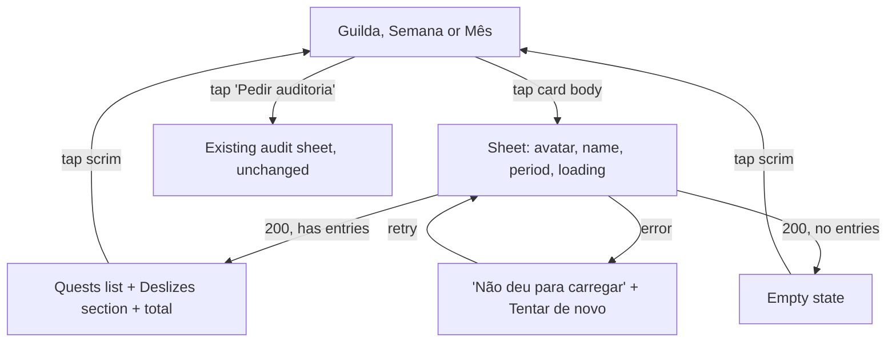

# Member score breakdown: tap a Guilda card to see how the points add up

Status: Done
Last updated: 2026-10-14
Depends on: none (builds on shipped `quest-entries.md` and `scoreboard.md`)

## Summary
On Guilda, tapping a member's card opens a bottom sheet listing the quests behind their score for the period selected in the Semana/Mês toggle: each quest's name, how many times it was done and the points it earned, plus slips (deslizes) in their own section. The sheet total always equals the number on the card. A new read-only endpoint, `GET /api/v1/scoreboard/members/:memberId?period=week|month`, returns the per-quest totals.

## Problem
Guilda shows each member's points and "N tarefas concluídas" (`front-end/app/(tabs)/guilda/page.tsx:124-145`) but not where they came from. Members can't check why a score is what it is, or follow how the others are doing quest by quest. The only entries endpoint, `GET /entries` (`back-end/internal/src/app/service/entry_service.go:118-132`), returns the caller's own entries only.

## Goals
- Tap any member's card on Guilda (yourself included) and see their quests for the selected period, grouped by quest, with count and points.
- The sheet's total equals the card's points, for both Semana and Mês.
- Works for quests that were renamed or deleted after being logged.
- "Pedir auditoria" on the card keeps working exactly as today.

## Non-goals
- Day-by-day detail (which days each quest was done) and proof photos. Confirmed with the user: counts only for v1.
- Past weeks (`/weeks/history`, `fim-de-semana`). Only the current week/month, as the toggle shows.
- Any change to ranking, points or how entries are logged.
- Per-member privacy settings. Scores are already guild-visible.
- The bottom-nav "Semana" screen. This spec is about the Semana/Mês toggle on the Guilda tab.

## Current state
- **Guilda page** (`front-end/app/(tabs)/guilda/page.tsx`): `view: "semana" | "mes"`, fetches `getScoreboard("week" | "month")` + `listGuildMembers()`, renders one `RankRow` per standing. On Semana, the row's children include a "Pedir auditoria" `Button` (or a "Você" badge / "Auditoria pendente" badge) and the `completedLabel` caption. The page already uses a `Sheet` for the audit confirmation (`asking` state).
- **`RankRow`** (`front-end/components/ui.tsx:185-212`): a plain `<div className="bq-rank">`, not interactive. Styles `globals.css:201-209`.
- **`Sheet`** (`front-end/components/ui.tsx:141-152`): scrim button + `role="dialog"` panel.
- **API client** (`front-end/lib/api.ts:113-116`): `Standing`, `Scoreboard`, `getScoreboard(period)`.
- **Scoreboard service** (`back-end/internal/src/app/service/scoreboard_service.go`): computes the period range (week = `entry.WeekStart(today)` to +6 days; month = 1st to last day) in the guild timezone (`America/Sao_Paulo`, `main.go`), then `EntryRepository.SumByGuild`.
- **Aggregation SQL** (`back-end/internal/src/infrastructure/postgres/entry_repository.go:111-128`): `SUM(points)` and `COUNT(*) FILTER (WHERE score_type = 'sum')` per member over `occurred_on BETWEEN from AND to`.
- **Entries table** (`migrations/0006_entries.sql`): each row snapshots `rule_id`, `rule_name`, `score_type` and signed `points` (negative for `decrease`). `rule_id` has no FK, so entries survive rule deletion.
- **Domain error** `entry.ErrMemberNotInGuild` already exists (`domain/entry/entry.go:17`).
- Scoreboard controller: `back-end/internal/src/interface/http/controllers/scoreboard_controller.go`; route `routes.go:66-67`; wiring `main.go:103,134`; OpenAPI `api/openapi.yaml:407`.

## User stories
- As a guild member, I want to tap my own card and see which quests gave me my points, so I can check the score is right.
- As a guild member, I want to tap someone else's card and see what they've been doing, so I can follow their progress (and decide whether to ask for an audit).

## UX flow



### Card (Guilda list)
- The whole card is tappable, except interactive children ("Pedir auditoria"), which keep their own action.
- No visual change besides the pressed state (no chevron; keep the card clean).

### Breakdown sheet
- Header (centered stack, like the audit sheet): `Avatar size="lg"`, `bq-title` with the member's name, `bq-caption` with the period label.
- **Quests** section: one row per quest, sorted by points descending, then name ascending. Each row: quest name (`bq-text`), `N×` and `+P` on the right (`bq-label`).
- **Deslizes** section, only if there are any: same row layout, points shown as `−P`.
- **Total** row at the bottom: `Total` and the signed sum, matching the card.
- Loading: `bq-caption` "Carregando…" with `role="status"`.
- Long lists scroll inside the sheet.
- Closing: tap the scrim (existing `Sheet` behavior). A ghost "Fechar" button at the bottom as well, like the audit sheet's "Agora não".

## Copy (pt-BR)
| Where | Text |
| --- | --- |
| Period caption, Semana | `Esta semana` |
| Period caption, Mês | `Este mês` |
| Section title | `Quests` |
| Section title (slips) | `Deslizes` |
| Count | `{n}×` |
| Points (quest) | `+{p}` |
| Points (slip) | `−{p}` (U+2212, like `RankRow`) |
| Total label | `Total` |
| Empty state title | `Nada por aqui ainda` |
| Empty state text, Semana | `{nome} ainda não marcou quests esta semana.` |
| Empty state text, Mês | `{nome} ainda não marcou quests este mês.` |
| Error title | `Não deu para carregar` |
| Error text | `Confira sua conexão e tente de novo.` |
| Retry button | `Tentar de novo` |
| Close button | `Fechar` |
| Card accessible name | `Ver quests de {nome}` |

Voice per `design/BRAND.md`: informal, no emoji, "deslize" never "erro".

## Business rules
1. The period and its date range are computed exactly like `ScoreboardService.List` (same week/month, same timezone), so the sheet and the card always cover the same days.
2. Items are grouped by `(rule_id, score_type)`. `count` = number of entries, `points` = sum of their signed points.
3. Display name of a group = `rule_name` of its most recent entry (`occurred_on DESC, created_at DESC`), so a renamed quest shows its latest name and a deleted quest still shows its last name.
4. `total` = sum of all items' points = the member's `points` on `GET /scoreboard` for the same period. `completed` = sum of `count` over `sum` items = the card's `completed`.
5. Any member of the caller's guild can be requested, including the caller. A `memberId` not in the caller's guild returns 404 (don't reveal whether the user exists).
6. Read-only: no writes, no new tables, no migration.

## Data model
No change. Reads `entries` only.

## Architecture & technical decisions

### Back-end
Follow the `add-feature` skill checklist; the existing scoreboard slice is the template.

- **Domain:** nothing new. Reuse `entry.ErrMemberNotInGuild` and `guild.ErrNotMember`.
- **App** (`internal/src/app/service/scoreboard_service.go`):
  - New types:
    ```go
    // QuestTotal is one member's aggregate for one quest over a period.
    type QuestTotal struct {
        RuleID    string
        RuleName  string
        ScoreType string // rule.ScoreTypeSum or rule.ScoreTypeDecrease
        Count     int
        Points    int
    }
    ```
  - `EntryRepository` (declared in `entry_service.go:27`) gains:
    ```go
    // SumByRule returns memberID's entries in guildID with occurredOn in [from, to],
    // grouped by (rule, score type), each named after its most recent entry.
    // A member with no entries in range gets an empty slice.
    SumByRule(ctx context.Context, guildID, memberID string, from, to time.Time) ([]QuestTotal, error)
    ```
  - Extract the period-range computation in `List` into an unexported helper (`periodRange(today, period) (from, to time.Time)`) and reuse it.
  - New method:
    ```go
    // Breakdown returns memberID's per-quest totals for period, sorted per Business rules,
    // with the range and today. Errors: guild.ErrNotMember (caller has no guild),
    // entry.ErrMemberNotInGuild (memberID not in the caller's guild).
    func (s *ScoreboardService) Breakdown(ctx context.Context, callerID, memberID string, period ScoreboardPeriod) (items []QuestTotal, from, to, today time.Time, err error)
    ```
    Resolves the caller's guild via `FindByMember`, checks `memberID` is in `g.UserIDs`, computes the range, calls `SumByRule`, sorts by points desc then name asc (stable sort in Go, not SQL, so the unit test covers it).
- **Infrastructure** (`internal/src/infrastructure/postgres/entry_repository.go`):
  ```sql
  SELECT rule_id,
         score_type,
         (ARRAY_AGG(rule_name ORDER BY occurred_on DESC, created_at DESC))[1] AS rule_name,
         COUNT(*)::int AS count,
         SUM(points)::int AS points
  FROM entries
  WHERE guild_id = $1 AND member_id = $2 AND occurred_on BETWEEN $3 AND $4
  GROUP BY rule_id, score_type
  ```
  Uses the existing `entries_member_occurred_idx (guild_id, member_id, occurred_on)`. Update any in-memory/fake `EntryRepository` used by tests.
- **Interface** (`scoreboard_controller.go`):
  - Extend `ScoreboardUseCase` with `Breakdown(...)`.
  - New handler `Breakdown` for `GET /scoreboard/members/:memberId`, reusing `bindScoreboardPeriod`.
  - Error mapping: `guild.ErrNotMember` → 403 (existing message); `entry.ErrMemberNotInGuild` → 404 `"member not found in your guild"`; else 500.
- **Routes** (`cmd/webapp/routes/routes.go`): `scoreboard.GET("/members/:memberId", c.Scoreboard.Breakdown)` (already behind `RequireAuth`).
- **Wiring:** none; `ScoreboardController` already gets `scoreboardService`.
- **OpenAPI** (`api/openapi.yaml`): add the path with `period` query, `memberId` path param, 200/400/401/403/404 responses and the `ScoreBreakdown` schema.

### Front-end
- **`lib/api.ts`:**
  ```ts
  export type QuestTotal = { ruleId: string; ruleName: string; scoreType: "sum" | "decrease"; count: number; points: number };
  export type ScoreBreakdown = { memberId: string; items: QuestTotal[]; total: number; completed: number; from: string; to: string; today: string };
  export const getScoreBreakdown = (memberId: string, period: ScoreboardPeriod) =>
    apiFetch<ScoreBreakdown>(`/scoreboard/members/${encodeURIComponent(memberId)}?period=${period}`);
  ```
- **`RankRow`** (`components/ui.tsx`): add optional `onOpen?: () => void` and `openLabel?: string`. When set:
  - Render an absolutely positioned `<button type="button" className="bq-rank__open" aria-label={openLabel} onClick={onOpen} />` covering the whole card (stretched-button pattern). `.bq-rank` gets `position: relative`.
  - Interactive children sit above it: `.bq-rank .bq-btn { position: relative; z-index: 1 }`. This avoids nesting a button inside a button (invalid HTML) and keeps "Pedir auditoria" working.
  - `.bq-rank__open`: transparent, no border, `inset: 0`, `border-radius: inherit`, `cursor: pointer`; `:active` gives the card a slight press (e.g. `transform: translateY(2px)` on the card via `.bq-rank:has(.bq-rank__open:active)`); `:focus-visible` uses the existing 3px ink outline.
  - Without `onOpen`, `RankRow` renders exactly as today (other callers unaffected).
- **New `components/ScoreBreakdownSheet.tsx`** (`"use client"`): props `member` (`{ id, name, avatar }`), `period: "week" | "month"`, `onClose`. Fetches on mount and when `member.id`/`period` change, with the same `active` flag pattern as `guilda/page.tsx` to drop stale responses. Renders the states from the UX flow inside `Sheet`.
- **`app/(tabs)/guilda/page.tsx`:** new state `viewing: string | null`. Each `RankRow` gets `onOpen={() => setViewing(s.memberId)}` and `openLabel={`Ver quests de ${toMember(s.memberId).name}`}`, in both Semana and Mês. Render `<ScoreBreakdownSheet>` when `viewing` is set, with `period` from `view`. Clear `viewing` when `view` changes (the sheet is closed by then anyway, since the toggle is behind the scrim).
- Use `useSession` only as today; the sheet needs no session data.

## API / contracts

`GET /api/v1/scoreboard/members/{memberId}?period=week|month` (auth required)

200:
```json
{
  "memberId": "beto",
  "items": [
    { "ruleId": "r1", "ruleName": "Beber 2 L de água", "scoreType": "sum", "count": 5, "points": 50 },
    { "ruleId": "r2", "ruleName": "Ler 20 minutos", "scoreType": "sum", "count": 2, "points": 30 },
    { "ruleId": "r9", "ruleName": "Esquecer a louça", "scoreType": "decrease", "count": 1, "points": -10 }
  ],
  "total": 70,
  "completed": 7,
  "from": "2026-10-12",
  "to": "2026-10-18",
  "today": "2026-10-13"
}
```
- `items` sorted by `points` desc, then `ruleName` asc; empty array (never null) when there are no entries.
- `points` is signed; `total` = sum of `points`; `completed` = sum of `count` where `scoreType == "sum"`. The controller computes `total`/`completed` from the items.

Errors: 400 bad `period`; 401 no/invalid token; 403 caller has no guild; 404 `memberId` not in the caller's guild; 500 otherwise. Body shape as in `interface/http/response`.

## Edge cases
- **Member with no entries:** 200 with `items: []`, `total: 0`; sheet shows the empty state.
- **Only slips:** Quests section hidden, Deslizes shown, negative total (matches the card's `−N`).
- **Quest renamed mid-period:** one row, latest name (rule 3).
- **Quest deleted:** still listed with its last name (entries keep `rule_name`).
- **Quest switched between sum and decrease:** two rows, one in each section (grouped by `(rule_id, score_type)`).
- **Weekly quest on Mês:** counted once per week it was done, as stored.
- **Entry logged while the sheet is open:** the sheet shows data as of open time; reopening refetches. Card and sheet may briefly differ; acceptable.
- **Period crosses midnight Sunday→Monday while open:** same as above; reopening fixes it.
- **Fast toggle Semana↔Mês:** the sheet is closed before the toggle is reachable; stale responses are dropped by the `active` flag.
- **Unknown or other-guild `memberId`:** 404; the front-end never sends one, but the sheet shows the error state if it happens.

## Accessibility, privacy & performance
- The card's open button has an accessible name ("Ver quests de {nome}"), a 3px focus ring and covers the full card (well above the 48px tap minimum). "Pedir auditoria" stays a separate focusable button.
- The sheet uses the existing `role="dialog" aria-modal="true"`. Loading text uses `role="status"`.
- Privacy: only per-quest aggregates, no dates, photos or `loggedBy`, and only within the caller's guild.
- Performance: one indexed aggregate query per sheet open; responses are a handful of rows.

## Decision log
All confirmed by the user on 2026-10-13 ("all recommended"):
1. Bottom sheet on card tap (not inline expand).
2. Follows the Semana/Mês toggle.
3. Per-quest rows with count and points, slips in their own section, total matching the card.
4. Counts only, no day-by-day detail or photos.
5. Any guild member can open any card, including their own.
6. "Pedir auditoria" keeps working; the rest of the card opens the sheet.
7. New aggregate endpoint instead of loading all guild entries client-side.

Made while writing the spec:
- Group by `(rule_id, score_type)` and name by latest entry, so totals match the card in every edge case.
- 404 (not 403) for a member outside the guild.
- Stretched-button pattern on `RankRow` to avoid nested buttons.

## Implementation plan
1. Back-end app: `QuestTotal`, `SumByRule` on `EntryRepository`, `periodRange` helper, `ScoreboardService.Breakdown`. Unit tests with the hand-written fake.
2. Back-end infra: `EntryRepository.SumByRule` SQL. Integration coverage via the HTTP test.
3. Back-end interface: controller handler + route + OpenAPI. Controller unit tests; integration test.
4. `make lint` and `make cover` (100%) from `back-end/`.
5. Front-end: `lib/api.ts` types/function, `RankRow` `onOpen`, CSS, `ScoreBreakdownSheet`, Guilda wiring.
6. `npm run lint` in `front-end/` (Node 22).
7. Manual run with the dev users (see Acceptance criteria).

## Acceptance criteria
1. On Guilda → Semana, tapping any member's card (outside "Pedir auditoria") opens the sheet with their avatar, name and "Esta semana".
2. Tapping "Pedir auditoria" opens the audit sheet only, not the breakdown.
3. The sheet lists each quest done this week with `N×` and `+P`, highest points first; slips appear under "Deslizes" with `−P`.
4. The sheet's Total equals the card's points, and the number of quest completions equals the card's "N tarefas concluídas", for every member, on both Semana and Mês.
5. On Mês, the sheet says "Este mês" and covers the whole month.
6. A member with nothing logged shows the empty state; a network failure shows the error state, and "Tentar de novo" reloads.
7. Renaming a quest after logging it shows the new name; deleting it still shows it in the sheet with its last name, and totals still match.
8. Your own card opens your breakdown too.
9. Keyboard: Tab reaches each card's open button and "Pedir auditoria" separately; Enter opens the right thing.
10. `GET /api/v1/scoreboard/members/<id-from-another-guild>?period=week` returns 404; `period=day` returns 400; no token returns 401.
11. `make lint`, `make cover` (100%) and front-end `npm run lint` pass.

## Test plan
- **Unit (`test/unit/scoreboard_service_test.go`):** `Breakdown` success (sorting by points then name; mixed sum/decrease), caller without guild → `guild.ErrNotMember`, member not in guild → `entry.ErrMemberNotInGuild`, repository error propagated, week and month ranges (incl. a Sunday and the 1st/last day of a month), empty result.
- **Unit (`test/unit/scoreboard_controller_test.go`):** 200 body incl. `total`/`completed` computed from items and `items: []` when empty; 400 bad period; 403; 404; 500.
- **Integration (`test/integration/scoreboard_test.go`):** through `routes.NewRouter` with Postgres (testcontainers): seed entries for two members incl. a renamed rule, a deleted rule and a slip; assert breakdown totals equal `GET /scoreboard` points/completed for week and month; 404 for a user outside the guild; 401 without token.
- **Front-end:** no runner; manual checklist above.

## Out of scope / follow-ups
- Day-by-day view and proof photos in the sheet.
- Breakdown for past weeks from `/weeks/history` / `fim-de-semana`.
- An "Pedir auditoria" button inside the sheet (could be handy once audits have a real back-end).

## Open questions
None.

## Notes for the implementing agent
- Read `front-end/AGENTS.md` before touching Next.js code; front-end needs Node ≥ 20.9 (`/opt/homebrew/opt/node@22/bin`).
- Follow the `add-feature` skill and CLAUDE.md back-end rules: interfaces live in the layer that uses them; 100% coverage of `./internal/...` and `./cmd/webapp/routes/...`.
- `back-end/.env` points at the production database. Don't use `make run`/`make dev`/`make migrate` with it for local testing; integration tests start their own Postgres.
- The card's "Pedir auditoria" and pending-audit state are local-only today (`pending` state in `guilda/page.tsx`); don't change that behavior here.
